# TriOrbit — System Architecture & Technical Specification

> **Task ID:** TRI-027
> **Status:** FINAL & APPROVED
> **Project:** TriOrbit Lunar Survival Simulator
> **Challenge:** NASA Space Apps Challenge 2026 — *Junior Astronaut Mission Trainer*
> **Lead Architecture Author:** Nirsanth A. (`@nirsanth23`)
> **Reviewed By:** Vibhushan Ganeshan (`@Vibhushan-2003`) & Abhinaya Jeyakumar (`@abhi190503`)
> **Integration Baseline:** Commit `46009cb` (`develop`)

---

## 1. Architecture Overview

**TriOrbit Lunar Survival Simulator** is architected as a modern, high-performance, browser-based web application leveraging the **Next.js App Router** with React 19 and TypeScript. The system is designed with a strict **unidirectional data flow** that cleanly isolates pure deterministic game engine simulation from presentation components, external NASA data ingestion, and accessibility layers.

### Architectural Principles
1. **Determinism:** The core simulation engine is a pure TypeScript state reducer. Given identical initial states and player action dispatches, outcomes and scores are 100% reproducible.
2. **Zero-Latency Client State:** In-game state transitions occur entirely in memory within the client browser, ensuring instant tactical feedback for young commanders aged 7–12 without server round-trip delays.
3. **Resilient Data Ingestion:** Real space weather observations from NASA CCMC DONKI are ingested via a dedicated Next.js Route Handler that handles API authentication, validation, caching, and automatic fallback to verified offline fixtures.
4. **Zero External Persistence:** To safeguard privacy, simplify classroom deployment, and ensure rapid loading on school Chromebooks, TriOrbit requires zero user authentication, zero external databases, and zero tracking cookies.

---

## 2. Technology Stack

| Layer | Technology | Version | Purpose |
|---|---|---|---|
| **Frontend Framework** | Next.js (App Router) | 16.4.6 | Server and client rendering, route grouping, static asset pipeline |
| **UI Library** | React | 19.3.0 | Component lifecycle, hooks (`useReducer`, `useState`), declarative UI |
| **Type System** | TypeScript | 5.x | Strict type contracts across engine, telemetry, and API layers |
| **Styling Engine** | Tailwind CSS | 4.3.3 | Responsive utility styling, dark mode space palette, animations |
| **Vector Graphics** | Inline SVG | Native | Lightweight, responsive 2.5D lunar base visualization |
| **API Integration** | Next.js Route Handler | Serverless / Node | Server-side proxy for NASA DONKI API (`/api/nasa/events`) |
| **Test Framework** | Node.js Test Runner | Native (Node 20+) | High-speed unit, integration, regression, and SSR smoke tests |

---

## 3. High-Level System Architecture Diagram

```mermaid
flowchart TD
    subgraph Client ["Client Browser (Ages 7–12 Experience)"]
        Landing["LandingScreen<br/>(Briefing & Tutorial)"]
        Mission["MissionScreen<br/>(Core Game Shell)"]
        Base["LunarBaseScene<br/>(2.5D SVG Base Hotspots)"]
        HUD["MissionHUD<br/>(0–100 Vital Telemetry)"]
        Controls["ActionControls<br/>(2 Maintenance Actions/Day)"]
        EventModal["EventModal<br/>(NASA Space Weather Dilemmas)"]
        ScienceDrawer["ScienceDrawer<br/>(5 NASA Heliophysics Facts)"]
        Results["ResultsScreen<br/>(Debrief, Score & Replay)"]
    end

    subgraph Engine ["Pure Deterministic TypeScript Engine (src/lib/game/)"]
        Contracts["contracts.ts<br/>(GameState, VitalResources, Actions)"]
        CoreEngine["engine.ts<br/>(gameReducer, applyAction, clamp)"]
        Progression["progression.ts<br/>(advanceDay, checkSurvival, win/loss)"]
        Scoring["scoring.ts<br/>(Deterministic 0–1000 Score Model)"]
    end

    subgraph Server ["Next.js Server & Backend (App Router)"]
        RouteHandler["GET /api/nasa/events<br/>(Route Handler)"]
        DONKILib["donki.ts<br/>(NASA Client & Schema Normalizer)"]
        OfflineFixture["verified-events.json<br/>(Bundled Offline Fallback)"]
    end

    subgraph NASA ["NASA Open Data & Heliophysics Repositories"]
        DONKIAPI["NASA CCMC DONKI API<br/>(api.nasa.gov & ccmc.gsfc.nasa.gov)"]
    end

    Landing -->|Begin Mission| Mission
    Mission --> Base
    Mission --> HUD
    Mission --> Controls
    Mission --> EventModal
    Mission --> ScienceDrawer
    Mission --> Results

    Controls -->|Dispatch MAINTAIN_MODULE| CoreEngine
    EventModal -->|Dispatch RESOLVE_EVENT| CoreEngine
    CoreEngine -->|State Update| Mission
    Progression -->|Check Day / Win / Loss| CoreEngine
    Scoring -->|Calculate Final Outcome| Results

    RouteHandler --> DONKILib
    DONKILib -->|HTTPS Request with NASA_API_KEY| DONKIAPI
    DONKILib -.->|On Network Fault / 404 / Rate Limit| OfflineFixture
    EventModal -.->|Fetch Event Provenance| RouteHandler
```



---

## 4. Application Structure & Directory Layout

```text
triorbit-lunar-mission/
├── docs/                               # Audited documentation & contracts
│   ├── ARCHITECTURE.md                 # System architecture (this document)
│   ├── ASSUMPTIONS.md                  # Scientific assumptions & educational boundaries
│   ├── ATTRIBUTION.md                  # Open-source licenses, assets & AI disclosures
│   ├── GAME_RULES.md                   # Frozen canonical simulation rules & formulas
│   ├── GITHUB_WORKFLOW.md              # Branching & integration guidelines
│   ├── INTERFACES.md                   # Frozen TypeScript data transfer objects
│   ├── PROJECT_SPEC.md                 # Product specifications & non-goals
│   ├── SCIENCE_SOURCES.md              # NASA data provenance & citations
│   └── TEST_RESULTS.md                 # 17-point QA verification evidence
├── public/                             # Public static assets & SVGs
│   └── images/lunar-base-cinematic.webp# Base background artwork
├── src/
│   ├── app/                            # Next.js App Router routes
│   │   ├── api/nasa/events/route.ts    # Server-side NASA DONKI proxy handler
│   │   ├── globals.css                 # Base Tailwind styling & tokens
│   │   ├── layout.tsx                  # Root layout & metadata
│   │   ├── page.tsx                    # Landing page route (/)
│   │   └── play/page.tsx               # Main simulation route (/play)
│   ├── components/                     # Modular React UI components
│   │   ├── events/EventModal.tsx       # Space weather dilemma modal
│   │   ├── game/                       # Mission UI & HUD components
│   │   │   ├── ActionControls.tsx      # Maintenance allocation controls
│   │   │   ├── LandingScreen.tsx       # Landing screen & 30-sec tutorial
│   │   │   ├── LunarBaseScene.tsx      # Interactive 2.5D SVG lunar base
│   │   │   ├── MissionHUD.tsx          # 5-vital gauge telemetry display
│   │   │   ├── MissionScreen.tsx       # Game shell & state binding
│   │   │   └── ModuleHotspot.tsx       # Base module interactive hotspots
│   │   ├── learn/ScienceDrawer.tsx     # Educational NASA facts drawer
│   │   └── results/ResultsScreen.tsx   # Mission outcome debrief & replay
│   ├── data/                           # Static data & bundled fixtures
│   │   ├── nasa/verified-events.json   # Bundled historical DONKI SEP events
│   │   ├── scenarios.json              # 5-day educational dilemma definitions
│   │   └── science-facts.ts            # Curated heliophysics science facts
│   ├── lib/                            # Core simulation & integration logic
│   │   ├── game/                       # Canonical pure TypeScript engine
│   │   │   ├── contracts.ts            # Canonical GameState, vitals, actions
│   │   │   ├── engine.ts               # Pure reducer & invariant enforcement
│   │   │   ├── progression.ts          # Day lifecycle & outcome logic
│   │   │   └── scoring.ts              # Deterministic score calculator
│   │   └── nasa/donki.ts               # NASA API client & normalizer
│   └── tests/                          # Automated QA test suite
│       └── integration/
│           ├── loader.mjs              # Node.js ESM TypeScript loader
│           ├── register.mjs            # Module registration hook
│           └── smoke-regression.test.ts# 17-suite automated regression test
└── submission/                         # Submission artifacts
    ├── DEMO_LINK.txt                   # Verified public presentation link
    ├── DEMO_SCRIPT.md                  # Six-slide demo storyboard & script
    └── PROJECT_DESCRIPTION.md          # Competition description & 50–200 word summary
```

---

## 5. Component Responsibilities

### Presentation Layer (`src/components/`)
1. **`LandingScreen.tsx` (`/`):**
   - Welcomes learners with clear, encouraging language.
   - Provides an optional 30-second mission briefing explaining the 5-day cycle and 2-action daily budget.
   - Dispatches start event routing directly to `/play`.
2. **`MissionScreen.tsx` (`/play`):**
   - Coordinates the top-level mission state using React `useReducer`.
   - Manages modal visibility (`EventModal`, `ScienceDrawer`, `ResultsScreen`).
   - Ensures responsive layout across desktop, tablet, and mobile displays.
3. **`LunarBaseScene.tsx` & `ModuleHotspot.tsx`:**
   - Visualizes the lunar surface base using clean, responsive 2.5D inline vector graphics.
   - Maps 4 distinct interactive habitat pods with status indicators and focus-visible keyboard navigation:
     - *Habitat Module (Life Support):* Oxygen generation and atmospheric recycling.
     - *Solar & Battery Station:* Solar energy collection and auxiliary power reserves.
     - *Hydroponics Greenhouse:* Crop growth, fresh food yield, and water recycling.
     - *Shielded Regolith Bunker:* Deep-subsurface radiation haven beneath lunar regolith.
4. **`MissionHUD.tsx`:**
   - Displays mission telemetry: Current Day ($1–5$), Actions Remaining ($0–2$), and 5 normalized resource gauges ($0–100$).
   - Dynamically color-codes vital bars (Cyan/Emerald for nominal, Amber for caution, Crimson for emergency depletion).
5. **`ActionControls.tsx`:**
   - Provides accessible touch and button targets ($\ge 44\text{px}$) for allocating maintenance actions.
   - Accurately disables action buttons when the daily budget of 2 actions is exhausted or when an emergency dilemma is pending.
6. **`EventModal.tsx`:**
   - Renders scheduled space weather dilemmas (Days 2, 3, and 4) with WAI-ARIA accessible dialog semantics.
   - Confines keyboard focus, announces authentic NASA spacecraft observation badges, and presents clear trade-off choices.
7. **`ScienceDrawer.tsx`:**
   - Accessible slide-over panel displaying 5 curated heliophysics and lunar exploration facts.
   - Features direct external links to `api.nasa.gov` and `ccmc.gsfc.nasa.gov`, complete with clear educational caveats.
8. **`ResultsScreen.tsx`:**
   - Renders post-mission analysis for both *Mission Accomplished* (survived Day 5) and *Mission Aborted* (resource depleted or radiation critical).
   - Breaks down surviving vital averages, emergency mistake counts, final score ($0–1000$), and provides a 1-click state reset button.

---

## 6. Canonical Game Engine Architecture

The game simulation logic (`src/lib/game/`) is strictly separated from React components and UI libraries. It consists of pure TypeScript functions with zero side effects:

### Core Modules
- **`contracts.ts`:**
  Defines frozen data contracts:
  - `VitalResources`: `{ oxygen: number; power: number; water: number; food: number; radiationRisk: number }`
  - `GameState`: Complete mission state tree including current day, vitals, remaining actions, event status, mistake counts, and log.
  - `GameAction`: Discriminated union of player actions (`MAINTAIN_MODULE`, `RESOLVE_EVENT`, `ADVANCE_DAY`, `RESTART_MISSION`).
  - `ModuleId`: `'life-support' | 'power-station' | 'greenhouse' | 'regolith-bunker'`.
- **`engine.ts`:**
  Implements the state transition function:
  ```typescript
  export function gameReducer(state: GameState, action: GameAction): GameState
  ```
  - Applies module yields and costs deterministically.
  - Clamps all vitals strictly within the invariant boundary $[0, 100]$.
  - Enforces that `DAILY_DRAIN.radiationRisk === 0` (radiation changes exclusively via active events or bunker actions).
  - Decrements the daily action budget ($2 \to 1 \to 0$).
- **`progression.ts`:**
  - Governs day transitions (`advanceDay`).
  - Evaluates baseline end-of-day resource drains:
    - Oxygen: $-8$
    - Power: $-10$
    - Water: $-5$
    - Food: $-4$
  - Evaluates win/loss termination conditions:
    - Immediate failure if $\text{vital} \le 0$ or $\text{radiationRisk} \ge 100$.
    - Victory if Day 5 completes with all systems nominal.
- **`scoring.ts`:**
  Computes the final score ($0–1000$) using deterministic weighting:
  $$\text{Score} = \text{clamp}\left(200 \times \text{daysSurvived} + \frac{\sum \text{vitals}}{5} - 50 \times \text{mistakes}, 0, 1000\right)$$

---

## 7. NASA DONKI API Integration & Fallback Strategy

### Route Handler: `src/app/api/nasa/events/route.ts`
TriOrbit provides a centralized server-side Route Handler that manages all communication with NASA Open APIs:

1. **Authentication Protection:**
   The optional `NASA_API_KEY` is loaded from server environment variables. Client code never receives or stores the API key.
2. **Endpoint Querying:**
   Queries NASA CCMC DONKI for historical Solar Energetic Particle (SEP) events:
   `https://api.nasa.gov/DONKI/SEP?startDate=2024-05-01&endDate=2024-05-15&api_key=...`
3. **Data Normalization:**
   Transforms raw NASA telemetry into normalized `NASAEventDTO` objects containing event ID, timestamp, instrument metadata, and official CCMC source URLs.
4. **Fault-Tolerant Offline Fallback:**
   If the NASA API is unreachable, encounters rate limits (HTTP 429), or network is disconnected, the Route Handler seamlessly falls back to bundled historical fixture data:
   `src/data/nasa/verified-events.json`
   This guarantees that TriOrbit functions with 100% reliability in offline classrooms and judging environments.

---

## 8. Data Boundaries & Scientific Caveats

TriOrbit maintains a rigorous distinction between authentic astrophysical observations and simplified educational game mechanics:

```text
┌──────────────────────────────────────────────────────────────┐
│                  AUTHENTIC NASA OPEN DATA                    │
│  • Event ID: 2024-05-11T04:07:00-SEP-001                     │
│  • Timestamp: 11 May 2024, 04:07 UTC                         │
│  • Source: NASA CCMC DONKI / STEREO A Spacecraft             │
│  • Measurement: 13–100 MeV Interplanetary Proton Flux        │
└──────────────────────────────┬───────────────────────────────┘
                               │ Contextual Ingestion
                               ▼
┌──────────────────────────────────────────────────────────────┐
│                 EDUCATIONAL SIMULATION MODEL                 │
│  • Day 2 Dilemma: Solar Energetic Particle Warning           │
│  • Vitals: Normalized 0–100 Game Points (NOT physical units) │
│  • Power -5 / Radiation Risk +5 (Calibrated Game Effects)    │
│  • Regolith Bunker: Subterranean Radiation Attenuation       │
└──────────────────────────────────────────────────────────────┘
```

1. **No Dosimetry Claims:** Orbital satellites observe proton flux in interplanetary space. TriOrbit does **not** claim to calculate physical absorbed radiation dose (Sieverts / Grays) on the lunar surface.
2. **Normalized Points:** Vitals are educational game points, not kilograms ($kg$), liters ($L$), or kilowatt-hours ($kW$).

---

## 9. Accessibility, Motion & Responsive Design

- **WAI-ARIA Conformance:** Modals (`EventModal`, `ScienceDrawer`) utilize `role="dialog"`, `aria-modal="true"`, `aria-labelledby`, and `aria-describedby` with automatic focus trapping.
- **Keyboard Usability:** All interactive base modules and maintenance buttons support full `Tab` sequence, `Enter` / `Space` activation, and `Escape` to close drawers.
- **Touch-Friendly Targets:** All buttons satisfy WCAG minimum target sizes ($\ge 44 \times 44\text{px}$).
- **Reduced Motion:** Visual transitions respect user accessibility preferences (`prefers-reduced-motion`).

---

## 10. Verification & Test Architecture

The application is validated by a 25-suite deterministic regression test harness (`src/tests/integration/smoke-regression.test.ts`):
- **Native ESM TypeScript Execution:** Utilizes Node.js custom loader hooks (`loader.mjs`, `register.mjs`) for rapid execution without compilation overhead.
- **Deterministic Assertions (124/124 Passing):** Validates initial state invariants, action exhaustion, scenario scheduling, choice effects, failure triggers, and score reproducibility.
- **Hydration & SSR Resilience:** Confirms that all core screens render cleanly in server-side environments with zero console errors or hydration mismatches.
