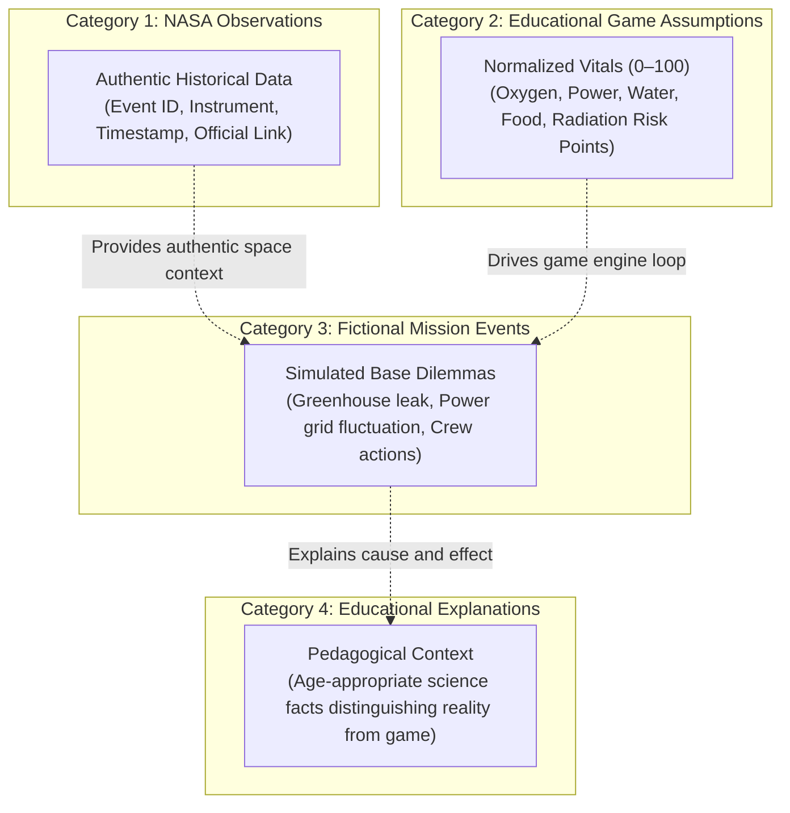
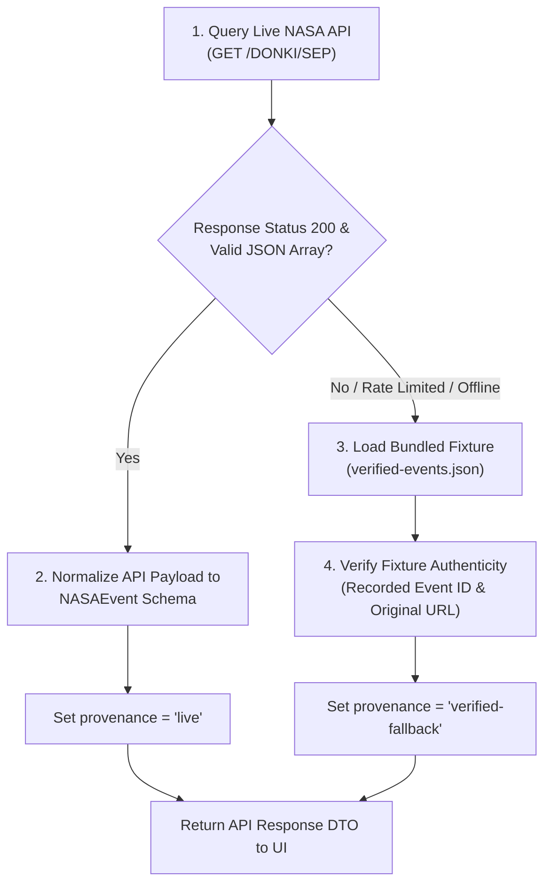

# Scientific Assumptions and Educational Model — TriOrbit Lunar Survival Simulator

> **Document:** `docs/ASSUMPTIONS.md`
> **Task ID:** TRI-002 (Issue #2)
> **Workstream:** Nirsanth NASA / Science / QA (`work/nirsanth-science`)
> **Lead Researcher:** Nirsanth A. (`@nirsanth23`)
> **Independent Reviewer:** Vibhushan Ganeshan (`@Vibhushan-2003`)
> **Status:** VERIFIED FOR REVIEW
> **Date Verified:** 14 November 2026

---

## 1. Classification of Mission Information

To maintain rigorous scientific honesty and prevent misconceptions among learners, all data and statements in TriOrbit are categorized into four distinct classes:



### Category 1: NASA Observations (Real Space Weather History)
- **Nature:** Empirical observational data recorded by NASA spacecraft instruments and compiled by NASA GSFC / CCMC.
- **Examples:**
  - NASA Event ID: `2024-05-11T04:07:00-SEP-001`
  - Observation Timestamp: `2024-05-11T04:07Z`
  - Detector: `STEREO A: IMPACT 13-100 MeV`
  - Source Link: `https://ccmc.gsfc.nasa.gov/DONKI/view/SEP/30717/-1`
- **Rule:** Never altered, fabricated, or mathematically transformed into human biological injury.

### Category 2: Educational Game Assumptions (Calibrated Game Units)
- **Nature:** Artificial numeric values that parameterize the game engine's resource balance.
- **Examples:**
  - Life Support Vital Metrics: Oxygen, Power, Water, Food, and Radiation Risk (all clamped in `[0, 100]`).
  - Action costs: e.g., Generating oxygen consumes 15 Power points and yields 20 Oxygen points.
- **Rule:** These numbers are pedagogical abstractions designed to teach resource trade-offs; they are **not** real-world physical or physiological measurements.

### Category 3: Fictional Mission Events (Narrative Scenarios)
- **Nature:** Synthetic narrative situations designed to present players with tactical mission choices.
- **Examples (Canonical 5-Day Schedule):**
  - Day 2: Solar Energetic Particle alert (`solar-activity`) based on authentic NASA spacecraft telemetry.
  - Day 3: Habitat Electrical Grid Fluctuation (`power-outage`) simulating substation circuit breaker trip.
  - Day 4: Hydroponic Irrigation Line Emergency (`greenhouse-water`) simulating manifold pressure drop.
- **Rule:** Fictional habitat events must be clearly presented as training simulations, even when triggered by a real historical NASA bulletin.

### Category 4: Educational Explanations (Science Communication)
- **Nature:** Child-friendly explanatory text connecting player choices to real scientific concepts (solar radiation, water recycling, plant respiration).
- **Rule:** Every explanation must maintain a clear distinction between real space science facts and fictional game calculations.

---

## 2. Normalized Educational Game Units vs. Physical Measurements

All life-support vitals in TriOrbit are represented as **normalized game points ranging from 0 to 100**.

| Game Vital | In-Game Range | Display Label | Real Physical Equivalent (NOT MODELED) | Scientific Boundary & Justification |
|---|---|---|---|---|
| `oxygen` | 0 – 100 | Oxygen Level (%) | Partial pressure $pO_2 \approx 21\text{ kPa}$, Mass flow (kg/day) | Abstracted to simplify gas consumption for ages 7–12. |
| `power` | 0 – 100 | Battery Grid (%) | Kilowatt-hours ($\text{kWh}$), Voltage, Solar irradiance ($W/m^2$) | Abstracted to avoid electrical engineering complexity. |
| `water` | 0 – 100 | Potable Water (%) | Volume (Liters), Recycling efficiency rates ($\%$) | Abstracted to focus on conservation trade-offs. |
| `food` | 0 – 100 | Nutrition Stores (%) | Kilocalories ($\text{kcal}$), macronutrient balance | Abstracted to represent stored rations and fresh yields. |
| `radiationRisk` | 0 – 100 | Storm Alert (%) | Absorbed dose ($\text{Gray}$), Equivalent dose ($\text{Sievert}$) | **CRITICAL:** Not a biological radiation dose measurement. |

### Explicit Non-Equivalence Declarations
1. **No Dosimetry Claims:** `radiationRisk` is an indicator of habitat alert status and shield exposure level. A value of 80% `radiationRisk` indicates a critical game hazard, **not** that astronauts have absorbed 0.8 Gy or 0.8 Sv of ionizing radiation.
2. **No Physical Consumption Rates:** Daily vital reductions (e.g., $-10$ Oxygen/day) are chosen for game balance across a 5-day cycle, not derived from NASA Human Systems Integration Standards (NASA-STD-3001).
3. **Pure Engine Separation:** Game mechanics execute purely deterministic arithmetic. No NASA API data is piped directly into a mathematical multiplier to calculate astronaut injury.

---

## 3. Scientific Limitations and Caveats

1. **Spacecraft vs. Lunar Surface Environment:**
   - Detectors on STEREO A or GOES satellites operate in interplanetary space or Earth's geostationary orbit.
   - The lunar surface environment has unique geometric shielding (the Moon blocks approximately $2\pi$ steradians of the sky) and localized magnetic anomalies, which differ substantially from satellite observation points.
2. **Solar Flare Class is Not Surface Dose:**
   - A GOES soft X-ray solar flare classification (e.g., X5.8) measures electromagnetic flux in Earth orbit. Electromagnetic radiation travels at the speed of light ($c$) and arrives in ~8.3 minutes, while energetic charged particles (protons) travel slower and follow interplanetary magnetic field lines (Parker spiral).
   - An intense flare does not guarantee an immediate high particle flux at every celestial body.
3. **Shielding Physics Simplification:**
   - In TriOrbit, directing the crew to the "Shielded Bunker" mitigates `radiationRisk`.
   - In reality, shielding against galactic cosmic rays (GCRs) and high-energy solar protons requires thick lunar regolith shielding ($\ge 2\text{ to }3\text{ meters}$), hydrogenous materials (polyethylene, water walls), and careful secondary Bremsstrahlung radiation mitigation.
4. **Target Demographic:**
   - Designed for learners aged **7–12**. The pedagogical objective is fostering decision-making skills and scientific curiosity, not training operational flight surgeons or mission directors.

---

## 4. Educational Language Standards (Ages 7–12)

Narratives and explanations must be exciting, scientifically accurate, and free of alarmist or medically graphic exaggerations.

### Approved Narrative Pattern
> *"Mission Control has received a real historical solar-particle-activity bulletin recorded by NASA spacecraft. Your job is to decide how to protect the crew in this fictional training scenario."*

### Why This Phrasing is Scientifically & Pedagogically Sound:
- **Attribution Accuracy:** Explicitly attributes the bulletin to real NASA spacecraft history.
- **Role Clarity:** Places the player in a simulated command role ("fictional training scenario").
- **Clear Demarcation:** Explains that the bulletin is real, but the bunker and resource impacts belong to the simulator.
- **Non-Fatalistic Tone:** Emphasizes proactive problem-solving ("decide how to protect") rather than graphic harm.

### Prohibited Phrasing:
- ❌ *"NASA data shows your astronauts are receiving fatal radiation sickness!"* (False claim of medical dosimetry).
- ❌ *"The solar flare is burning your lunar base!"* (Scientific absurdity; flares are solar atmospheric releases).
- ❌ *"NASA measured 75 points of radiation on the Moon today."* (Falsely portrays game points as NASA measurements).

---

## 5. Historical Fallback Provenance Method

To guarantee robust operation during public demonstrations, classroom sessions, or when network access / NASA API keys are unavailable, TriOrbit specifies an offline **verified fallback fixture** mechanism.

### Provenance Workflow


### Frozen Interface Compliance (`planning/INTERFACES.md`)
The downstream API endpoint (`GET /api/nasa/events`) must conform to the following contract:

```typescript
interface NASAEvent {
  id: string;
  type: 'FLR' | 'SEP';
  occurredAt: string;
  title: string;
  sourceUrl: string;
  classType?: string;
  source: 'NASA DONKI';
}

interface NASAEventsResponse {
  events: NASAEvent[];
  provenance: 'live' | 'verified-fallback';
  retrievedAt: string;
  caution: string;
}
```

### 10-Step Mandatory Provenance Procedure
1. **Authentic NASA Ingestion:** A fallback fixture must be created solely from an authentic NASA API response or official NASA catalog notification. Fabricating synthetic observation records is strictly prohibited.
2. **Canonical Event Identifier:** Preserve the exact NASA-assigned event ID (e.g., `2024-05-11T04:07:00-SEP-001`).
3. **Traceable Source URL:** Embed the exact CCMC canonical link (e.g., `https://ccmc.gsfc.nasa.gov/DONKI/view/SEP/30717/-1`).
4. **Observation Timestamp:** Retain the original detector observation timestamp in ISO 8601 UTC (`2024-05-11T04:07Z`).
5. **Retrieval Timestamp:** Record the exact date and time the record was verified and bundled (`retrievedAt: "2026-11-14T11:12:00Z"`).
6. **No Value Modification:** Do not tamper with observed timestamps or instrument labels.
7. **Intentional Normalization:** When mapping the payload to `NASAEvent`, document any formatting adjustments (such as generating a child-friendly title from the event ID and instrument name).
8. **Schema Validation:** Ensure the fallback JSON passes the TypeScript interface validation before bundling.
9. **In-App Citation Display:** The Science Drawer must render the source citation and original URL regardless of whether the record came from live API or verified fallback.
10. **Explicit Provenance Flag:** The API response must explicitly set `provenance: 'verified-fallback'` whenever the offline fixture is served, ensuring full transparency in the user interface.

---

## 6. Scientific Assumption Register

| Assumption ID | Statement | Classification | Supporting Reference | Scientific Limitation | Owner | Status |
|---|---|---|---|---|---|---|
| **ASM-001** | Historical SEP event on 11 May 2024 detected by STEREO A represents an authentic severe space weather sequence. | Category 1 (NASA Observation) | NASA DONKI SEP ID `2024-05-11T04:07:00-SEP-001`; Alert 30728/1 | Sensed at STEREO A spacecraft, not lunar surface. | Nirsanth A. | **VERIFIED** |
| **ASM-002** | Base life support vitals are modeled as normalized points bounded in $[0, 100]$. | Category 2 (Game Assumption) | `docs/PROJECT_SPEC.md` §2; `planning/GAME_RULES.md` | Abstract educational metrics, not SI physical units. | Vibhushan G. | **VERIFIED** |
| **ASM-003** | An active SEP alert increases lunar base `radiationRisk` unless crew takes shelter. | Category 2 (Game Assumption) | TriOrbit Game Rules | Simplified cause-and-effect model for learners. | Vibhushan G. | **VERIFIED** |
| **ASM-004** | A 5-day survival run requires managing 2 player actions per day with 4 base modules. | Category 2 (Game Assumption) | `docs/PROJECT_SPEC.md` §2 | Game structure tailored for 30-minute play sessions. | Abhinaya J. | **VERIFIED** |
| **ASM-005** | Space weather alerts are received by fictional habitat Mission Control as historical bulletins. | Category 3 (Fictional Event) | TriOrbit Narrative Specification | Mission context is fictional; bulletin metadata is real. | Nirsanth A. | **VERIFIED** |
| **ASM-006** | Hydroponic greenhouses consume water and power to generate food and supplemental oxygen. | Category 2 (Game Assumption) | CSA Space Food Education Resources | Simplified bioregenerative cycle; rates are educational. | Nirsanth A. | **VERIFIED** |
| **ASM-007** | Radiation exposure is mitigated by moving crew into a shielded regolith bunker module. | Category 2 (Game Assumption) | NASA Lunar Architecture Studies | Surface bunker shielding physics are highly abstracted. | Vibhushan G. | **VERIFIED** |
| **ASM-008** | Dropping any vital to 0 or reaching 100 `radiationRisk` aborts the mission. | Category 2 (Game Assumption) | `docs/PROJECT_SPEC.md` §2 | Clear educational win/loss boundary. | Vibhushan G. | **VERIFIED** |

---

## 7. Downstream Science Handoff Specifications

This document and `docs/SCIENCE_SOURCES.md` serve as the scientific contract for downstream tasks:

1. **TRI-010 (NASA DONKI Route Handler — Nirsanth):**
   - Implement `GET /api/nasa/events` conforming to `planning/INTERFACES.md`.
   - Query `GET /DONKI/SEP` with date parameters or gracefully serve `verified-fallback` with `2024-05-11T04:07:00-SEP-001`.
   - Ensure the server-side API key is loaded from private `NASA_API_KEY`, defaulting to `DEMO_KEY` when omitted.
2. **TRI-011 (Curated Scenario Content — Nirsanth):**
   - Author Day 2 space weather dilemma referencing `2024-05-11T04:07:00-SEP-001`.
   - Include educational text using the approved language patterns defined in §4.
3. **TRI-018 (Science & Educational Drawer — Nirsanth):**
   - Render the standard citation format defined in `docs/SCIENCE_SOURCES.md` §10.
   - Display the scientific honesty disclosure distinguishing spacecraft observations from game points.
4. **TRI-021 (QA & Scientific Evidence Audit — Nirsanth & Vibhushan):**
   - Verify that no synthetic event records have been committed under `NASA DONKI` attribution.
   - Audit downstream components to ensure no claim of biological radiation dosimetry is presented.

---

## 8. Post-Integration Science & Assumptions Reconciliation (TRI-025)

**Reconciliation Date:** 14 November 2026
**Auditor:** Nirsanth A. (`@nirsanth23`)
**Integration Baseline SHA:** `5ee917a7d0f6138ad739be9af998abbc0c258835` (`develop`)

### 8.1 Reconciliation of Documentation and Canonical Game Contracts
An exhaustive audit across `docs/ASSUMPTIONS.md`, `docs/GAME_RULES.md`, `docs/INTERFACES.md`, and the integrated code confirmed:
1. **Normalized Units:** All 5 vitals are strictly bounded integers in $[0, 100]$ representing educational game points. No physical units (liters, kilograms, kilowatt-hours, grays, or sieverts) are calculated or claimed in the simulation engine.
2. **Radiation Risk Dynamics:** Verified that `DAILY_DRAIN.radiationRisk === 0`. Radiation hazard changes exclusively through active player decisions (e.g. bunker shielding) or space weather events.
3. **Scenario Timing:** Reconciled illustrative early planning drafts to align with the frozen implementation schedule: Day 2 (`solar-activity`), Day 3 (`power-outage`), and Day 4 (`greenhouse-water`).
4. **External Documentation Defect Logged:** Identified in `README.md` (Line 14) that physical unit abbreviations ($kW$, $L$, $kg$) were placed next to resource names. Logged for README owner (`@abhi190503`) to update in the final documentation polishing pass.
5. **Post-Integration Verification:** Verified through 124 passing end-to-end integration assertions that all assumptions operate deterministically in the running application.
