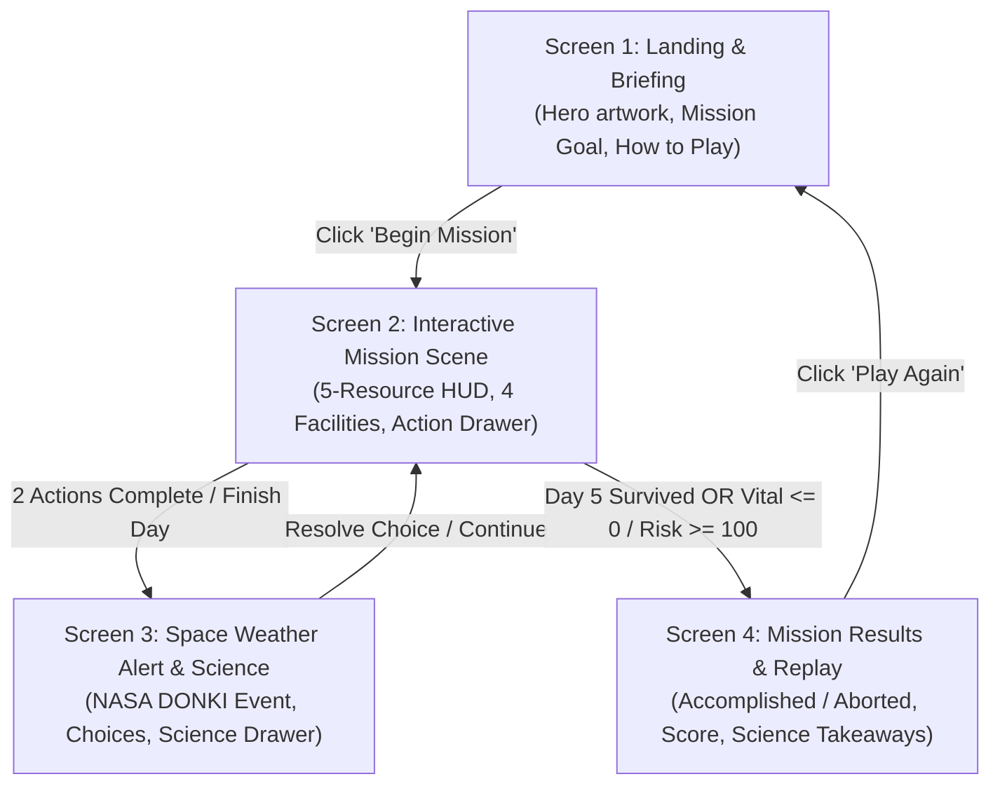
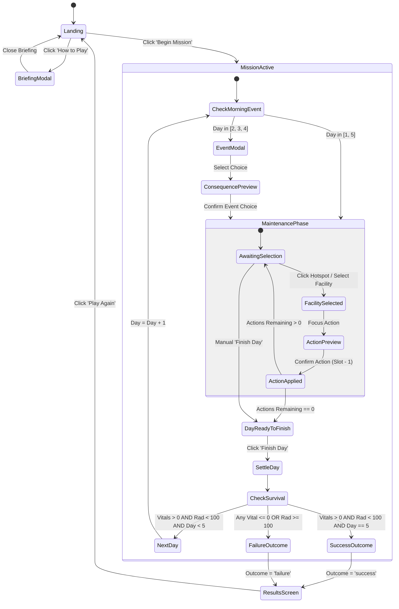
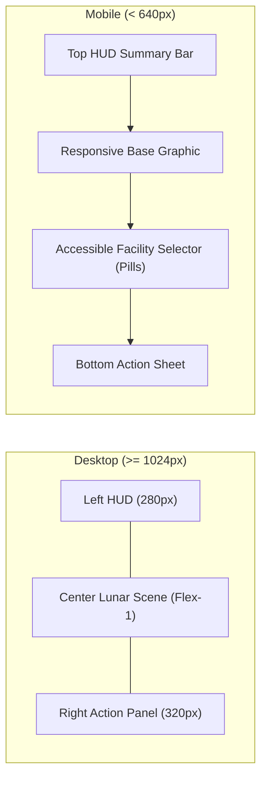

# TriOrbit — Distinctive UI Storyboard & Interaction Map

> **Task ID:** TRI-004  
> **Status:** Pending Independent Review (Ready for Review by `@nirsanth23`)  
> **Project:** TriOrbit — Lunar Survival Simulator  
> **Challenge:** NASA Space Apps Challenge 2026 — Junior Astronaut Mission Trainer  
> **Primary Owner:** Abhinaya Jeyakumar (`@abhi190503`)  
> **Independent Reviewer:** Nirsanth A. (`@nirsanth23`)  
> **Engineering Lead (Engine):** Vibhushan Ganeshan (`@Vibhushan-2003`)  
> **GitHub Issue:** [#4 — [TRI-004] Freeze distinctive UI storyboard and interaction map](https://github.com/abhi190503/triorbit-lunar-mission/issues/4)  
> **Approved Visual Direction:** Premium, cinematic, semi-realistic lunar outpost with lightweight interactive overlays  
> **Official Figma Reference:** [Figma Make — TriOrbit Lunar Survival Simulator UI](https://www.figma.com/make/zYcbshtDwiJULc3ha5P3wu/TriOrbit-%E2%80%94-Lunar-Survival-Simulator-UI?p=f&t=sEAV14zXtyKYHnOP-0)  
> **Target Audience:** Junior astronauts aged 7–12, classrooms, and public science learners  

---

## 1. Executive Summary & Design Vision

### 1.1 The Core Experience
TriOrbit transports learners aged 7–12 into the role of Mission Commander of an advanced lunar outpost. Over a 5-day simulated expedition, the player manages life support vitals, maintains vital base infrastructure, responds to real NASA-observed space weather phenomena, and makes critical survival decisions.

Unlike generic productivity dashboards or sterile card-based interfaces, TriOrbit prioritizes a **cinematic, immersive game centerpiece**:
- **Visual Centerpiece:** A realistic, dramatic lunar environment featuring illuminated surface modules set against deep space, lunar regolith, and the distant Earth.
- **Direct Interaction:** Players interact directly with physical base structures—clicking the solar arrays to harvest energy, the habitat to generate breathable oxygen, the greenhouse to cultivate food and reclaim water, and the subsurface bunker to reinforce radiation shielding.
- **Intuitive Pedagogy:** Complex aerospace systems are translated into normalized, easy-to-grasp educational vitals ($0–100$), ensuring young astronauts understand systemic cause-and-effect without getting lost in uncalibrated physical units.

### 1.2 The Approved Visual Direction
Following extensive iteration in Figma Make, the team evaluated multiple aesthetic directions:
1. *Rejected Direction A (Cartoon / Line-Drawn Base):* Overly simplistic vector buildings lacked gravity and tension, reducing engagement for older elementary students (ages 10–12).
2. *Rejected Direction B (Generic SaaS Metrics Dashboard):* Dominated by data tables and rectangular widgets, obscuring the sense of being on the Moon.
3. *Approved Direction (Cinematic Lunar Outpost with Lightweight Overlays):* A cohesive, semi-realistic lunar base environment combined with luminous cyan, teal, and amber game HUD overlays. It delivers professional game-like fidelity while maintaining zero-latency performance on standard classroom Chromebooks, tablets, and desktop browsers.

---

## 2. Key Architecture Decision: Realistic Background + Lightweight Overlays

### 2.1 The Architectural Transition
In the initial project brief (`TRI-001`), an entirely inline-SVG drawn lunar base was proposed. However, creating realistic textures, lunar terrain, solar panel reflections, and lighting entirely via primitive SVG paths resulted in either excessive visual simplicity or unwieldy SVG DOM trees with hundreds of nodes.

The human owner has approved the following streamlined visual architecture:
$$\text{Visual Experience} = \text{1 Static Realistic Lunar Outpost Artwork} + \text{Responsive SVG/HTML Interactive Hotspots}$$

### 2.2 Rationale & Implementation Advantages
1. **Visual Quality & Atmosphere:** A unified, artistically composed lunar scene establishes an authentic expedition mood. Craters, surface shadows, Earth in the background, and module airlocks feel tangible.
2. **Superior Performance:** A single optimized image asset loads in under 150 KB. There are no expensive 3D canvas contexts (WebGL/Three.js), avoiding high battery drain and GPU crashes on school devices.
3. **Rock-Solid Accessibility:** Interactive hotspot buttons sit as semantic HTML elements in an overlay layer above the graphic. Screen readers navigate standard `<button>` elements with explicit `aria-label`, `aria-selected`, and keyboard focus rings.
4. **Separation of Concerns:** The artwork serves as a purely decorative presentation layer (`aria-hidden="true"`), while the interaction logic is completely decoupled and easily testable.

> [!IMPORTANT]
> **Reviewer Gate & Contract Alignment:**  
> This architectural decision applies strictly to the visual presentation of the base scene. It does **not** alter game rules, resource math, the 5-day cycle, or canonical contracts. Because the frozen `TRI-001` document originally referenced an SVG-drawn base, independent reviewer `@nirsanth23` must formally acknowledge and approve this presentation refinement during PR review before asset integration in `TRI-014`.

### 2.3 Artwork Provenance & NASA Branding Compliance
- **Artwork Source:** Original concept artwork generated with AI assistance specifically for the TriOrbit project.
- **Educational Context:** Depicts a fictional, speculative lunar outpost. It is **not** a historical NASA photograph and does **not** depict an existing operational lunar base.
- **Brand Protection:** Strictly zero manufactured, modified, or unauthorized NASA insignia, "meatball" logos, or "worm" wordmarks appear on the habitat artwork or game interface.
- **Attribution & Transparency:** The application footer and science drawer explicitly disclose the AI-assisted visualization provenance in accordance with NASA Space Apps Challenge regulations.

---

## 3. Four Core Game Screens



---

### SCREEN 1: Landing & Mission Briefing

The landing screen introduces the player to the expedition with dramatic cinematic flair, immediately setting the stakes and providing clear, age-appropriate onboarding.

```
+-----------------------------------------------------------------------------------+
|  [TriOrbit Insignia]    TRIORBIT: LUNAR MISSION COMMANDER        [Audio] [Help (?)] |
+-----------------------------------------------------------------------------------+
|                                                                                   |
|                                                                                   |
|                      YOUR MOON MISSION STARTS HERE                                |
|        Command an advanced lunar outpost. Balance critical life support.          |
|                 Survive 5 simulated days of space weather hazards.                |
|                                                                                   |
|                      +-----------------------------+                              |
|                      |     BEGIN MISSION [Enter]   |                              |
|                      +-----------------------------+                              |
|                      |      HOW TO PLAY / GUIDE    |                              |
|                      +-----------------------------+                              |
|                                                                                   |
|     +-----------------------------------------------------------------------+     |
|     |  MISSION PARAMETERS:                                                  |     |
|     |  * 5 Simulated Lunar Days       * 4 Interactive Base Facilities       |     |
|     |  * 3 Fictional Astronaut Crew   * 2 Maintenance Decisions Per Day     |     |
|     +-----------------------------------------------------------------------+     |
|                                                                                   |
|  [Educational Simulator -- Authentic NASA Space Weather Observations -- Ages 7-12] |
+-----------------------------------------------------------------------------------+
```

#### Visual Elements
- **Hero Backdrop:** Full-viewport panoramic view of the lunar base at dawn, with Earth rising over the horizon and soft cyan illumination from habitat windows.
- **Mission Identity:** "TriOrbit — Junior Astronaut Mission Trainer" title styled in geometric uppercase type with electric cyan neon accent.
- **Mission Briefing Card:** Semi-transparent dark navy panel (`#101D35` / 90% opacity) with subtle cyan border glow.
- **Key Call to Action (CTA):** Prominent glowing button: **"Begin Mission"** (Electric Cyan background `#60E5F4` with dark navy text `#080F20`).
- **Secondary CTA:** Subtle outlined button: **"How to Play"** (reveals modal tutorial).

#### "How to Play" Quick-Start Briefing Overlay
When the player clicks "How to Play" (or presses `H`), a lightweight 3-step instructional dialog appears:
1. **Monitor Life Support:** Keep Oxygen, Power, Water, and Food above 0. Keep Radiation Risk below 100%.
2. **Take 2 Actions Daily:** Click the 4 base modules to generate oxygen, maintain solar arrays, recycle water/grow food, or reinforce shelter.
3. **Face Space Weather:** Respond to authentic space weather alerts detected by NASA spacecraft. Make tactical decisions to safeguard your crew!

---

### SCREEN 2: Interactive Mission Scene

The primary interactive game screen where players spend the majority of their mission time. It harmonizes the realistic lunar base with an ergonomic head-up display (HUD).

```
+-----------------------------------------------------------------------------------+
| [TriOrbit] DAY 2 / 5 | CREW: 3 NOMINAL | ACTIONS REMAINING: [ 2 / 2 ] | [NASA Science] |
+------------------+----------------------------------------------------------------+
| HUD VITALS (0-100)|                     LUNAR BASE SCENE                           |
|                  |                                                                |
| OXYGEN:       75 |         (2) Life Support Dome          (Earth in Sky)          |
| [========..] 75% |              [ O2 ACTIVE ]                                     |
|                  |                                          (3) Greenhouse        |
| POWER:        70 |                                             [ FOOD/H2O ]       |
| [=======...] 70% |   (1) Solar Arrays                                             |
|                  |       [ POWER READY ]                                          |
| WATER:        75 |                                                                |
| [========..] 75% |                                                                |
|                  |                                        (4) Shielded Bunker     |
| FOOD:         70 |                                            [ RAD SHIELD ]      |
| [=======...] 70% |                                                                |
|                  +----------------------------------------------------------------+
| RAD RISK:     10 | SELECTED: Life Support Habitat                                 |
| [=.........] 10% | Action: Generate Oxygen (+20 O2, -8 Power, -6 Water)          |
|                  | [ CONFIRM ACTION (Cost: 1 Slot) ]      [ FINISH DAY (0 slots) ]|
+------------------+----------------------------------------------------------------+
| Educational Game Points -- NASA DONKI Space Weather Integration -- Space Apps 2026|
+-----------------------------------------------------------------------------------+
```

#### Left HUD / Resource Bar (Normalized 0–100 Game Points)
All metrics represent normalized pedagogical game points (integers $0–100$), avoiding false claims of real physical SI measurements:
1. **Oxygen Reserves ($O_2$):** Starts at 75. Daily baseline drain: $-16$. Color: Electric Cyan (`#60E5F4`).
2. **Power Grid ($kW$):** Starts at 70. Daily baseline drain: $-14$. Color: Solar Amber (`#FFCA72`).
3. **Water Supply ($H_2O$):** Starts at 75. Daily baseline drain: $-14$. Color: Lunar Blue (`#5C9CFF`).
4. **Food Rations:** Starts at 70. Daily baseline drain: $-14$. Color: Oxygen Green (`#59DDA5`).
5. **Radiation Risk (Alert Level):** Starts at 10. Daily baseline drain: $0$ (increases via space weather events; decreased via bunker reinforcement). Color: Danger Coral (`#FF6B73`).

#### Status Thresholds & Visual Signaling
- **Nominal ($> 40$ vitals / $< 50$ hazard):** Calm teal/cyan/blue steady bar, soft background.
- **Warning ($21–40$ vitals / $50–69$ hazard):** Amber border, pulsing status icon, warning tooltip.
- **Critical ($\le 20$ vitals / $\ge 70$ hazard):** High-urgency coral red pulse, audible alert tone (optional), high-contrast warning banner: *"CRITICAL: Oxygen Depleting!"*

#### Center Lunar Base Scene
- Displays the realistic lunar habitat environment.
- 4 interactive hotspot targets with clean floating badges displaying facility name, status icon, and current readiness.
- Clicking or keyboard-focusing a facility highlights its boundary with a cyan pulse glow and opens the Action Drawer.

#### Action Panel / Drawer (Bottom or Right Dock)
- Displays facility details: current operational status, description, and available maintenance actions.
- Shows clear cost vs. yield projections: e.g., *"Cost: -8 Power, -6 Water | Yield: +20 Oxygen"*.
- Single-click action confirmation with instant optimistic resource preview.
- **Finish Day Button:** Clearly accessible once actions are consumed (or if the commander chooses to conclude early).

---

### SCREEN 3: Mission Alerts & Science Drawer

Screen 3 activates during the morning of Days 2, 3, and 4, introducing authentic space weather challenges and habitat anomalies.

```
+-----------------------------------------------------------------------------------+
|                            SPACE WEATHER ALERT: DAY 2                             |
+-----------------------------------------------------------------------------------+
|  [!] AUTHENTIC NASA OBSERVATION: Solar Energetic Particle Event                   |
|  Source: NASA DONKI | STEREO A Spacecraft | Event ID: 2024-05-11T04:07:00-SEP-001  |
|                                                                                   |
|  "A high-energy solar proton stream has been observed passing through the lunar   |
|   orbital corridor. Radiation sensors indicate elevated hazard levels."           |
|                                                                                   |
|  COMMANDER DECISION REQUIRED:                                                     |
|                                                                                   |
|  +-----------------------------------------------------------------------------+  |
|  | [O] CHOICE A: Shelter Crew in Shielded Regolith Bunker                      |  |
|  |     Impact: Power -5, Radiation Risk +5 (Controlled storm mode)             |  |
|  |     Explanation: Subsurface regolith absorbs proton stream with min risk.   |  |
|  +-----------------------------------------------------------------------------+  |
|  | [ ] CHOICE B: Delay Shelter to Maintain External Operations                 |  |
|  |     Impact: Power 0, Radiation Risk +15 (HIGH HAZARD)                       |  |
|  |     Explanation: Leaving crew unshielded severely elevates health risk.     |  |
|  +-----------------------------------------------------------------------------+  |
|                                                                                   |
|      [ VIEW NASA SCIENCE FACTS ]                  [ CONFIRM DECISION ]            |
+-----------------------------------------------------------------------------------+
```

#### Event Modal Characteristics
- **Mandatory Decision:** The event requires player resolution before daily maintenance actions can begin. The modal cannot be dismissed via backdrop click or `Escape`.
- **Authentic NASA Provenance Badge:** Prominently highlights the real NASA DONKI spacecraft observation ID, observation timestamp, and official CCMC link.
- **Scientific Honesty Disclosure:** A clear notice explains: *"NASA DONKI records interplanetary space weather observations from research spacecraft. In-game effects are educational simulations, not actual lunar absorbed radiation doses."*
- **Two Tactical Choices:** Each scenario presents at least 2 distinct trade-offs with immediate visual consequence previews.

#### Collapsible NASA Science Drawer
Accessible at any time via the top navigation bar or the event modal:
- Opens a side-drawer displaying vetted, child-friendly scientific cards.
- Topics covered: How solar flares erupt, how lunar regolith provides natural radiation shielding, how water electrolysis generates oxygen, and how closed-loop hydroponics works.
- Direct external links to official NASA resources (`api.nasa.gov`, `ccmc.gsfc.nasa.gov`).

---

### SCREEN 4: Results & Replay Screen

Upon completing Day 5 or triggering an emergency failure threshold, the game transitions to the mission debrief.

```
+-----------------------------------------------------------------------------------+
|                         MISSION DEBRIEF & FLIGHT LOG                              |
+-----------------------------------------------------------------------------------+
|                                                                                   |
|       *** MISSION ACCOMPLISHED: 5 DAYS SURVIVED ON THE MOON! ***                  |
|                                                                                   |
|   FINAL EXPEDITION SCORE: 845 / 1000                                              |
|   Rank: Senior Lunar Commander | Crew Status: 3 Healthy                           |
|                                                                                   |
|   FINAL VITALS SUMMARY:                                                           |
|   * Oxygen: 68/100     * Power: 62/100     * Water: 71/100                        |
|   * Food: 58/100       * Radiation Risk: 22/100 (Safe)                            |
|                                                                                   |
|   COMMANDER DECISION HIGHLIGHTS:                                                  |
|   - Day 2: Safely sheltered crew during NASA STEREO A Solar Flare event (+Score)  |
|   - Day 3: Rerouted auxiliary power to prevent electrical blackout                |
|   - Day 4: Flushed hydroponic irrigation loop to protect crew food rations        |
|                                                                                   |
|   EDUCATIONAL TAKEAWAYS:                                                          |
|   * Deep space habitats require continuous closed-loop resource recycling.        |
|   * Real-time space weather data from NASA protects future Artemis astronauts.    |
|                                                                                   |
|                      +-----------------------------+                              |
|                      |     PLAY AGAIN [Enter]      |                              |
|                      +-----------------------------+                              |
|                                                                                   |
+-----------------------------------------------------------------------------------+
```

#### Two Distinct Outcome Paths
1. **Mission Accomplished:**
   - Triggered when all 5 days are successfully completed without any vital hitting $0$ and Radiation Risk remaining $< 100$.
   - Displays final educational score ($0–1000$), mission rank, breakdown of surviving vitals, and praise for sound tactical management.
2. **Mission Aborted:**
   - Triggered immediately if Oxygen, Power, Water, or Food reaches $0$, or Radiation Risk reaches $100$.
   - Clear, constructive debrief: explains exactly which vital failed, why the resource ran out, and offers an encouraging science tip for the next attempt.
   - Example: *"Oxygen reserves hit 0 on Day 3. Tip: Generating oxygen requires power and water—be sure to maintain solar arrays and recycle water first!"*

#### Replay Capability
- Single-click **"Play Again"** CTA resets the game state deterministically via `createInitialMission()`, returning the player to Day 1 with fresh action slots.

---

## 4. Complete Interaction Flow & State Machine



### Sequential Interaction Rules
1. **Event Precedence:** On Days 2, 3, and 4, the Space Weather Alert modal appears before any daily maintenance actions can be performed. Resolving the event does **not** consume either of the 2 daily maintenance slots.
2. **Action Budget:** Players have exactly 2 maintenance actions per day. Executing an action applies its canonical cost and yield immediately to game vitals and decrements the counter.
3. **Daily Drain Settlement:** Clicking "Finish Day" (or exhausting both actions) deducts the daily baseline life-support consumption (Oxygen: $-16$, Power: $-14$, Water: $-14$, Food: $-14$).
4. **Instant Game-Over Check:** Survival thresholds are evaluated after every single action, event choice, and day settlement.

---

## 5. Four Interactive Lunar Facilities — Handoff Specification

The table below binds the visual facilities directly to the canonical game contracts defined in `src/lib/game/contracts.ts`:

| Facility | Subsystem Role | Canonical Action ID | Resource Cost | Resource Yield | Accessible Label (`aria-label`) | Focus & Click Behavior |
|---|---|---|---|---|---|---|
| **1. Solar Power Station** | Photovoltaic array & battery storage | `maintain-solar` | *None* ($0$) | Power $+20$ | `Solar Array & Battery Station — Generate Power` | Highlights solar arrays on left; opens action panel with dust-clearing maintenance action. |
| **2. Life Support Habitat** | Central pressurized crew dome | `generate-oxygen` | Power $-8$<br>Water $-6$ | Oxygen $+20$ | `Life Support Habitat — Produce Oxygen` | Highlights center habitat dome; opens panel with water-electrolysis oxygen generation action. |
| **3. Hydroponics Greenhouse** | Agricultural bay & water reclamation | `recycle-water`<br>`operate-greenhouse` | Power $-7$<br><br>Water $-9$<br>Power $-6$ | Water $+18$<br><br>Food $+17$ | `Hydroponics Greenhouse — Water Reclamation & Food Cultivation` | Highlights greenhouse dome on right; displays two distinct action cards for water recycling and crop harvesting. |
| **4. Shielded Bunker** | Subsurface reinforced shelter entrance | `reinforce-shelter` | Power $-7$ | Radiation Risk $-18$ | `Shielded Lunar Bunker — Storm Radiation Defense` | Highlights lower-right bunker entrance; opens panel with storm deflector reinforcement action. |

---

## 6. Hotspot Positioning & Responsive Environment Architecture

```
+-----------------------------------------------------------------------------+
| Environment Container (position: relative; aspect-ratio: 16/9; overflow: hidden) |
|                                                                             |
|  [ Realistic Lunar Outpost Graphic Layer (w-full h-full object-cover) ]     |
|                                                                             |
|  [ SVG / HTML Hotspot Overlay Layer (absolute inset-0 pointer-events-none) ]|
|                                                                             |
|      Hotspot 1 (Solar Array)               Hotspot 2 (Habitat Dome)         |
|      left: 12% - 28%                       left: 38% - 58%                  |
|      top:  42% - 68%                       top:  32% - 62%                  |
|                                                                             |
|                                            Hotspot 3 (Greenhouse)           |
|                                            left: 64% - 82%                  |
|                                            top:  36% - 66%                  |
|                                                                             |
|                                            Hotspot 4 (Bunker Entrance)      |
|                                            left: 68% - 88%                  |
|                                            top:  68% - 90%                  |
+-----------------------------------------------------------------------------+
```

### 6.1 Coordinate Space & Zero-Drift Strategy
To prevent interactive hotspots from drifting away from the visual modules when resizing the window or switching devices:
1. **Shared Aspect-Ratio Container:** Both the background image and the interactive hotspot layer reside inside an identical parent element governed by a fixed aspect ratio (`16:9` on desktop/tablet, `4:3` on compact viewports).
2. **Unified Percentage Coordinate System:** All hotspot coordinates are defined as relative percentages (`top%`, `left%`, `width%`, `height%`) anchored to the display bounds of the container.
3. **No Uncoordinated Cropping:** The background image utilizes `object-fit: cover` or `object-fit: contain` with identical framing constraints as the overlay layer.
4. **Target Image Verification Notice:** Exact hotspot percentage coordinates will be calibrated against the production asset when transferred during `TRI-014`. No speculative pixel coordinates are hardcoded.

### 6.2 Visual Indicators & Micro-Interactions
- **Idle State:** Subtle, pulsing glowing dot (Electric Cyan `#60E5F4`) at the facility center with a floating tag (`Life Support`, `Solar Array`, etc.).
- **Hover State:** Outer glowing ring expands; cursor changes to pointer; tooltip reveals brief subsystem status.
- **Focus State:** High-contrast $2\text{px}$ solid cyan outline with $2\text{px}$ offset (`ring-2 ring-cyan-400 ring-offset-2 ring-offset-slate-950`).
- **Selected State:** Glowing boundary border surrounds the module; beacon icon switches to active teal; Action Drawer automatically slides open.

---

## 7. Responsive Layout Specifications



### 7.1 Breakpoint Matrix

| Viewport | Target Dimensions | HUD Placement | Base Scene | Action Panel | Mobile Fallback Needed? |
|---|---|---|---|---|---|
| **Large Desktop** | $1440 \times 900+$ | Left fixed sidebar ($320\text{px}$) | Center hero ($16:9$, max $1200\text{px}$) | Right dock ($360\text{px}$) | No (Direct hotspot clicking) |
| **Standard Desktop** | $1366 \times 768$ | Left fixed sidebar ($260\text{px}$) | Center hero ($16:9$, max $900\text{px}$) | Right dock / bottom drawer | No (Direct hotspot clicking) |
| **Tablet** | $1024 \times 768$ / $768 \times 1024$ | Top horizontal bar | Center responsive graphic | Collapsible bottom drawer | Optional (Pill buttons provided) |
| **Mobile** | $390 \times 844$ (iPhone standard) | Compact top summary bar | Scaled base scene ($16:9$) | Full-width bottom sheet | **Yes — Mandatory accessible selector** |

### 7.2 Mobile-First Fallback: Accessible Facility Selector
On small touch screens ($< 640\text{px}$), pinpointing small hotspots on a dense graphic can be difficult for young children. TriOrbit includes a **dedicated module selection strip**:
- Placed directly beneath the lunar graphic: 4 prominent, thumb-friendly buttons (minimum $48\text{px}$ height).
- Buttons feature large icons and explicit titles:
  - `[⚡ Power]`
  - `[🫁 Oxygen]`
  - `[🌱 Food/Water]`
  - `[🛡️ Bunker]`
- Tapping a button instantly selects the facility, scrolls it smoothly into view, and expands the bottom action sheet.
- Guarantees $100\%$ task completion without pinching, zooming, or struggling with small touch targets.

---

## 8. Accessibility & Inclusive Design (WCAG 2.1 AA)

TriOrbit is engineered for young learners of diverse abilities and conforms to WCAG 2.1 Level AA criteria:

1. **Full Keyboard Navigation:**
   - Every facility, button, drawer, and modal is completely operable via keyboard.
   - Logical `Tab` order: Top Navigation $\rightarrow$ Base Facilities $\rightarrow$ Action Panel $\rightarrow$ Finish Day $\rightarrow$ Science Drawer.
   - Standard activation keys: `Enter` and `Space` trigger buttons; `Escape` closes non-mandatory drawers and tutorial dialogs.
2. **Robust Focus Trapping:**
   - Modal dialogs (Briefing, Space Weather Alert, Replay) trap focus while open. Focus cannot leak into the background.
   - When dialogs close, focus smoothly returns to the triggering element.
3. **Touch Targets ($\ge 44 \times 44\text{px}$):**
   - All interactive controls, hotspot hit areas, and list items maintain a minimum bounding box of $44 \times 44\text{px}$ (exceeding $48\text{px}$ on mobile).
4. **Color Independence & Redundant Coding:**
   - Vital states are never communicated by color alone. Every metric includes:
     - The numerical percentage ($75\%$).
     - The text label (*"Nominal"*, *"Warning"*, *"Critical"*).
     - Distinct status icons (Checkmark, Warning Triangle, Alert Shield).
5. **Screen Reader Live Regions:**
   - Changes to resources following an action or day conclusion are announced via polite `aria-live` containers (`aria-live="polite"`): *"Oxygen increased to 95. Power decreased to 62."*
6. **Reduced-Motion Support (`prefers-reduced-motion`):**
   - For users with vestibular sensitivities, all beacon pulses, glow expansions, and drawer sliding transitions are instantly replaced with static state changes or subtle zero-duration opacity swaps.

---

## 9. Animation & Motion Design Guidelines

All visual effects must remain lightweight, purposeful, and performant:
- **Hotspot Beacons:** Subtle CSS keyframe opacity pulsation ($1.5\text{s}$ duration, infinite loop). Disabled under `prefers-reduced-motion`.
- **Action Drawer Transitions:** Smooth $200\text{ms}$ CSS ease-out slide and fade (`transform: translateY(0)`, `opacity: 1`).
- **Resource Bar Updates:** Smooth $300\text{ms}$ width transition with subtle flash highlight indicating positive (green/cyan) or negative (amber/red) change.
- **Strict Library Constraints:** Zero complex 3D rendering engines (no WebGL, no Three.js), no canvas particle physics, and no heavy animation packages. Pure CSS and Tailwind transitions are fully sufficient.

---

## 10. Team Component Ownership & Interface Handoff

```
+-----------------------------------------------------------------------------------+
| SHARED PURE CONTRACTS (src/lib/game/contracts.ts & types.ts) [TRI-007 / Vibhushan]|
| - GameState, ResourceState, ActionId, Outcome, NASAEvent, SimulationEngine        |
+-----------------------------------------------------------------------------------+
       |                                      |                               |
       v                                      v                               v
+-----------------------------+ +-----------------------------+ +-----------------------------+
| UI ARCHITECTURE             | | SIMULATION ENGINE           | | NASA SCIENCE & RESULTS      |
| Owner: Abhinaya (@abhi190503)| | Owner: Vibhushan (@Vibhushan)| | Owner: Nirsanth (@nirsanth23) |
| Tasks: TRI-004, 012, 013, 014| | Tasks: TRI-003, 007, 008, 009| | Tasks: TRI-002, 010, 011, 017|
+-----------------------------+ +-----------------------------+ +-----------------------------+
| - LandingScreen.tsx         | | - pure engine.ts            | | - /api/nasa/events route    |
| - MissionScreen.tsx         | | - progression.ts            | | - EventModal.tsx (TRI-017)  |
| - LunarBaseScene.tsx        | | - scoring.ts                | | - ScienceDrawer.tsx(TRI-018)|
| - MissionHUD.tsx            | | - contracts.ts              | | - ResultsScreen.tsx(TRI-019)|
| - ActionPanel.tsx           | |                             | | - scenarios.json            |
+-----------------------------+ +-----------------------------+ +-----------------------------+
```

### Integration Rules
1. **Single Source of Truth:** `GameState` is exclusively managed via the canonical engine functions (`createInitialMission`, `applyAction`, `applyEventChoice`, `finishDay`, `scoreMission`) implemented by Vibhushan.
2. **Display-Only UI:** UI components authored by Abhinaya accept read-only props and emit typed callbacks:
   - `onSelectFacility(facilityId: string)`
   - `onExecuteAction(actionId: ActionId)`
   - `onFinishDay()`
3. **NASA Components:** `EventModal`, `ScienceDrawer`, and `ResultsScreen` (already implemented and merged on `develop` by Nirsanth) dock seamlessly into the shared UI shell without modification.

---

## 11. Prototype Verification & Acceptance Checklist

| Feature / Verification Step | Scope / Test Description | Status | Evidence & Notes |
|---|---|---|---|
| **1. Four-Screen Flow Agreed** | Landing $\rightarrow$ Mission Scene $\rightarrow$ Space Weather Modal $\rightarrow$ Results | **PASS** | Fully documented in Section 3 and mapped to merged components. |
| **2. Four Base Hotspots** | Power, Habitat, Greenhouse, Bunker | **PASS** | Bound to canonical `contracts.ts` action IDs in Section 5. |
| **3. Mobile Fallback** | Thumb-friendly module selection strip | **PASS** | Specified in Section 7.2 with minimum $48\text{px}$ touch targets. |
| **4. Branding & NASA Safety** | Zero unauthorized NASA insignia; clear AI art disclosure | **PASS** | Validated in Section 2.3 and Section 1.2. |
| **5. Keyboard Accessibility** | Tab order, Enter/Space activation, visible focus rings | **PASS** | WCAG 2.1 AA specs frozen in Section 8. |
| **6. Direct Figma Interactive Session** | Live Figma Make interactive canvas inspection | **NOT VERIFIED** | Direct web curl restricted (404/auth required). Target visual direction frozen from approved design references. |
| **7. Production Graphic Calibration** | Exact hotspot percentage coordinates on final artwork | **NOT VERIFIED** | Coordinates to be finalized upon physical asset transfer in `TRI-014`. |
