# TriOrbit — Final Five-Minute Pitch Script & Live Demo Guide
## NASA Space Apps Challenge 2026 — Junior Astronaut Mission Trainer

> **Task ID:** TRI-028
> **Status:** READY FOR HUMAN REHEARSAL
> **Repository:** `abhi190503/triorbit-lunar-mission`
> **Target Integration Branch:** `develop`
> **Current Task Branch:** `docs/abhinaya-tri-028-pitch`
> **Verified Baseline Application Commit:** `6103cc5` (origin/develop)
> **Team TriOrbit:**
> - **Lead Presenter & UI Architect:** Abhinaya Jeyakumar (`@abhi190503`)
> - **Simulation Lead:** Vibhushan Ganeshan (`@Vibhushan-2003`)
> - **NASA Science & QA Lead:** Nirsanth A. (`@nirsanth23`)

---

## 1. Executive Presentation Overview

| Parameter | Target Specification | Status |
|---|---|---|
| **Competition Time Limit** | Strictly $\le$ 5 minutes (300 seconds) | Enforced |
| **Spoken Pitch Duration (Estimated)** | **4 minutes 35 seconds** (275 seconds) | **Estimated** (~135–140 words/min) |
| **Presenter Safety Buffer** | **25 seconds** reserved for judge transitions / pacing | Verified buffer |
| **Total Spoken Script Word Count** | **635 words** | Measured |
| **Live Human Rehearsal Status** | Pending team dry run | **NOT VERIFIED** (Human rehearsal required) |
| **Demonstration Format** | Live interactive browser application on `http://localhost:3000` | Verified on Next.js 16.4.6 build |
| **Backup Fallback Strategy** | Six-Slide Verified Storyboard (`submission/DEMO_SCRIPT.md`) | Verified available |
| **Target Audience** | Junior Astronauts aged 7–12, educators, and NASA Space Apps judges | Pedagogically calibrated |

---

## 2. Master Timing Architecture

```text
0:00 ───[ 0:25 ]─── 0:55 ───────[ 1:15 ]─────── 2:10 ───────[ 1:00 ]─────── 3:10 ────[ 0:55 ]──── 4:05 ──[ 0:30 ]── 4:35 ──[ 0:15 ]── 4:50 ──[ 0:10 ]── 5:00
 │        │           │                           │                           │                     │             │            │           │
 └─ Opening └─ Problem & └─ Live Base Operations &  └─ Authentic NASA Event &   └─ Outcomes, Scoring  └─ Science &  └─ Closing   └─ Buffer &
    & Mission  Audience     Daily Maintenance Loop     Dilemma Decision            & Instant Replay      Team Roles     Call to     Judge Q&A
    Vision     (Ages 7-12)  (Hotspots & 2 Actions)     (STEREO A Space Weather)   (Debrief & 0-1000)                   Action      Handoff
```

| Segment | Time Slot | Duration | Spoken Words | Target Screen / Interaction | Primary Objective |
|---|:---:|:---:|:---:|---|---|
| **1. Hook & Introduction** | 0:00–0:25 | 25s | ~60 words | Landing Screen (`/`) | Hook the judges, introduce TriOrbit, state mission premise |
| **2. Problem & Audience** | 0:25–0:55 | 30s | ~70 words | Landing Screen / 2.5D Base View | Explain the education gap for kids aged 7–12 and our solution |
| **3. Live Base Operations** | 0:55–2:10 | 75s | ~170 words | Mission Screen (`/play`) | Demonstrate 4 facilities, 5 vitals, and 2 daily maintenance actions |
| **4. Authentic NASA Dilemma** | 2:10–3:10 | 60s | ~140 words | Event Modal (Day 2 Alert) | Showcase real STEREO A solar storm observation and tactical trade-off |
| **5. Outcomes, Scoring & Replay**| 3:10–4:05 | 55s | ~125 words | Mission HUD & Results Screen | Settle daily drain, display 0–1000 score, debrief, and 1-click replay |
| **6. Science & Team Roles** | 4:05–4:35 | 30s | ~70 words | Science Drawer / Attribution | Detail scientific honesty, zero-database architecture, and team contributions |
| **7. Memorable Closing** | 4:35–4:50 | 15s | ~40 words | Victory Screen / Replay CTA | Strong final statement connecting young learners to the Artemis era |
| **8. Buffer & Q&A Transition** | 4:50–5:00 | 10s | 0 words | Standby / Ready for Questions | Safety pause; invite judges to ask questions |

---

## 3. Five-Minute Speaking Script (Solo Presenter — Abhinaya Jeyakumar)

> [!NOTE]
> **Delivery Instructions:** Speak naturally with a warm, energetic, confident tone. Do not rush. Pause briefly at screen transitions to let the visual changes sink in for the judges. Actions enclosed in brackets `[like this]` indicate physical clicks and gestures.

---

### Segment 1: Hook & Mission Vision (0:00–0:25 | ~60 words)
**Screen:** *Landing Screen (`http://localhost:3000`)*

> "Judges, imagine you are ten years old, stationed on the Moon, and your life-support alarms start chiming. On Earth, our atmosphere gives us endless air and shields us from cosmic radiation. On the Moon, every breath, every kilowatt-hour, and every gram of regolith shielding must be actively managed.
>
> Welcome to **TriOrbit**—a tactical lunar survival simulator designed for junior astronauts aged 7 to 12."

---

### Segment 2: The Problem & Our Young Learners (0:25–0:55 | ~70 words)
**Screen:** *Landing Screen (`/`) showing "Begin Mission" and 5-Day briefing badges*

> "Traditional science teaching often presents life support and heliophysics as passive textbook formulas that kids struggle to visualize. Young learners rarely get to experience the real operational cause-and-effect challenges of living on another world.
>
> TriOrbit transforms aerospace engineering into an intuitive, accessible web simulator. With zero logins, zero installations, and zero student data tracking, any classroom can launch straight into a simulated lunar mission on ordinary school Chromebooks or tablets."

---

### Segment 3: Live Base Operations & Resource Management (0:55–2:10 | ~170 words)
**Screen:** *Click `[Begin Mission]` $\rightarrow$ transitions to Mission Screen (`/play`)*

> `[Click: Begin Mission]`
>
> "Here is **Lunar Base Alpha**. Our visual interface features four interactive habitat modules set against a cinematic lunar landscape.
>
> In the upper right telemetry HUD, the commander monitors five normalized life-support vitals: **Oxygen, Power, Water, Food, and Radiation Risk**. Every resource is calibrated from zero to one hundred points. If any vital drops to zero, or if radiation risk hits one hundred, the mission aborts.
>
> Each morning, the commander receives exactly **two maintenance actions**. Over-allocating actions is impossible; every choice requires tactical prioritization.
>
> `[Click: SOLAR facility hotspot]`
>
> First, let's inspect our **Solar Power Station**. Maintaining our solar array clears lunar dust, restoring twenty units of power at zero cost.
>
> `[Click: Maintain Solar Array]`
>
> Notice our telemetry instantly updates: Power rises to ninety, and our daily action counter drops from two to one.
>
> `[Click: HABITAT facility hotspot]`
>
> Next, let's service the **Life Support Habitat**. Cycling life support generates twenty units of oxygen, consuming eight power and six water.
>
> `[Click: Cycle Life Support]`
>
> Both daily actions are now spent. We click `[Finish Day & Rest Crew]`, and our crew sleeps while baseline overnight life support drain is settled."

---

### Segment 4: Authentic NASA Event & Space Weather Dilemma (2:10–3:10 | ~140 words)
**Screen:** *Day 2 Space Weather Emergency Modal pops up*

> `[Click: Finish Day & Rest Crew]`
>
> "It is now Day 2, and Mission Control has intercepted an urgent space weather alert!
>
> This is not a random game event. This alert is powered by authentic NASA data from the **CCMC DONKI database**—specifically, an intense Solar Energetic Particle event observed by NASA's **STEREO A spacecraft on May 11th, 2024**. High-energy protons are streaming through the inner solar system.
>
> As commander, our young learner faces an immediate dilemma:
> - Option A: Spend five power points to shelter the crew inside our subterranean regolith bunker, safely absorbing the storm with minimal risk.
> - Option B: Delay shelter to keep surface operations running, saving power but exposing the crew to dangerous radiation.
>
> `[Click: Shelter crew in shielded regolith bunker]`
>
> We choose safety and shelter our crew. The bunker's natural lunar soil shielding protects our astronauts, demonstrating how real lunar architecture protects human explorers."

---

### Segment 5: Outcomes, Scoring & Instant Replay (3:10–4:05 | ~125 words)
**Screen:** *Mission HUD $\rightarrow$ Results Screen (`ResultsScreen.tsx`)*

> "Once the storm is resolved, daily operations resume. If a commander neglects power or fails to manage radiation across the five days, life support collapses, triggering an educational debrief explaining exactly why the systems failed.
>
> `[Transition to Results Screen / Victory Debrief]`
>
> When our commander successfully navigates all five days, they reach **Mission Accomplished**. Our deterministic scoring model evaluates remaining resources, survival duration, and dilemma accuracy on a scale of zero to one thousand points.
>
> Best of all, right here is our `[Replay Mission]` button. With one click, the simulation resets cleanly to Day 1 with zero page reloads—encouraging children to test new conservation strategies, build resilience, and learn through playful iteration."

---

### Segment 6: Scientific Honesty, Architecture & Team Roles (4:05–4:35 | ~70 words)
**Screen:** *Click `[NASA Science]` button in HUD $\rightarrow$ Science Drawer slides in*

> `[Click: NASA Science button]`
>
> "Scientific transparency is central to TriOrbit. Our slide-over **Science Drawer** teaches kids why deep-space spacecraft sensors differ from lunar surface radiation, and all data links directly to official NASA repositories.
>
> Our team delivered this with clear engineering division:
> - **Vibhushan Ganeshan** engineered our pure, deterministic TypeScript simulation engine and scoring models.
> - **Nirsanth A.** integrated the NASA DONKI API route handler, science content, and twenty-five automated test suites.
> - And I designed the responsive 2.5D visual shell, interactive hotspots, and mission HUD."

---

### Segment 7: Memorable Closing & Artemis Vision (4:35–4:50 | ~40 words)
**Screen:** *Return to Lunar Base view or Victory Screen*

> "TriOrbit bridges the gap between complex NASA heliophysics and the curious minds of young learners. We are not just teaching kids how a lunar base works—we are inspiring the next generation of Artemis explorers who will actually live there.
>
> Thank you! We welcome your questions."

---

### Segment 8: Standby Buffer (4:50–5:00 | 10s Safety Buffer)
**Screen:** *Standby on browser window, ready for judges' questions.*

---

## 4. Alternate Three-Presenter Speaking Allocation

If Team TriOrbit presents collaboratively as a three-person panel, follow this exact handover allocation:

```text
Abhinaya Jeyakumar (0:00–2:10) ──> Nirsanth A. (2:10–3:10) ──> Vibhushan Ganeshan (3:10–4:50) ──> All (Q&A)
[UI / Mission Vision / Demo]        [NASA Data & Dilemma]        [Engine / Scoring / Replay]
```

### Speaker 1: Abhinaya Jeyakumar (0:00–2:10 | UI, Problem & Base Operations)
- **Covers:** Segment 1 (Hook), Segment 2 (Problem & Audience), Segment 3 (Live Base Operations).
- **Physical Action:** Controls the mouse/keyboard, clicks "Begin Mission", demonstrates Solar Station and Life Support maintenance, clicks "Finish Day".
- **Verbal Handover at 2:10:**
  > "...Now, as we finish Day 1 and enter Day 2, a space weather alert arrives. I’ll hand over to Nirsanth to explain our NASA data integration."

### Speaker 2: Nirsanth A. (2:10–3:10 | NASA Data, Science & Dilemmas)
- **Covers:** Segment 4 (Authentic NASA Event, STEREO A SEP storm, dilemma choice trade-offs, and regolith physics).
- **Physical Action:** Speaks while Abhinaya clicks "Shelter crew in shielded regolith bunker" on the shared screen.
- **Verbal Handover at 3:10:**
  > "...The bunker protects our crew. To explain how our simulation engine processes these outcomes, calculates scores, and enables instant replay, here is Vibhushan."

### Speaker 3: Vibhushan Ganeshan (3:10–4:50 | Engine, Scoring, Replay & Closing)
- **Covers:** Segment 5 (Outcomes, scoring formula, 1-click replay), Segment 6 (Deterministic engine architecture & team roles), Segment 7 (Closing & Artemis call to action).
- **Physical Action:** Speaks while Abhinaya shows the Results Screen and clicks the Replay button.
- **Concluding Line at 4:50:**
  > "...Inspiring the Artemis generation. Thank you, judges! Team TriOrbit is ready for your questions."

---

## 5. Screen-by-Screen Live Demonstration Walkthrough Guide

Follow these exact steps during the live pitch. This script uses the shortest credible, fully verified gameplay route:

```mermaid
flowchart LR
    S1["1. Landing Screen<br/>(Intro & Vision)"] -->|"Click 'Begin Mission'"| S2["2. Lunar Base Scene<br/>(Inspect 4 Pods & HUD)"]
    S2 -->|"Click SOLAR & Maintain"| S3["3. Action 1: Maintain Solar<br/>(Power: 70 -> 90)"]
    S3 -->|"Click HABITAT & Cycle"| S4["4. Action 2: Cycle Oxygen<br/>(O2: 75 -> 95, Actions: 0)"]
    S4 -->|"Click 'Finish Day'"| S5["5. Overnight Settlement<br/>(Advance to Day 2)"]
    S5 -->|"Modal Appears"| S6["6. NASA DONKI Dilemma<br/>(STEREO A SEP Storm)"]
    S6 -->|"Click 'Shelter Crew'"| S7["7. Resolve Dilemma<br/>(Safe Regolith Shielding)"]
    S7 -->|"Show Results/Evidence"| S8["8. Debrief & 0-1000 Score<br/>(ResultsScreen.tsx)"]
    S8 -->|"Click 'Replay Mission'"| S9["9. Instant State Reset<br/>(Fresh Day 1 State)"]
```



### Detailed Screen-by-Screen Table

| Step # | Screen & Route | User Interaction / Button Click | Expected Visual Change | Spoken Voiceover Line | Duration | Failure Recovery Plan |
|:---:|---|---|---|---|:---:|---|
| **1** | Landing Screen (`/`) | Inspect page; hover cursor over **"Begin Mission"** button. | Cinematic lunar background, floating title card, badges showing "5 Days" and "2 Actions/Day". | *"Judges, imagine you are ten years old, stationed on the Moon..."* | 25s | If page unrendered, press `Ctrl+F5` to hard refresh. |
| **2** | Transition | Click primary **"Begin Mission"** button (or press `Enter`). | Instant client-side route transition to `/play` with zero page reload. | *"Let's begin our mission at Lunar Base Alpha."* | 5s | If navigation stalls, manually navigate URL bar to `/play`. |
| **3** | Mission Screen (`/play`) | Point to 2.5D base scene, then point to right-hand **Mission HUD**. | 4 vector habitat modules visible; HUD displays 5 vitals: $O_2: 75$, Power: $70$, Water: $75$, Food: $70$, Rad: $10\%$. Action counter shows `2 / 2`. | *"In the upper right HUD, the commander monitors five normalized life-support vitals..."* | 20s | Verify HUD gauges render correctly with high-contrast text. |
| **4** | Mission Screen (`/play`) | Click **"SOLAR"** module hotspot (or click `SOLAR` in facility selector). | Solar array module highlights with glowing cyan border; ActionControls panel switches to "Solar Power Station". | *"First, let's inspect our Solar Power Station..."* | 10s | If hotspot click misses, click the `SOLAR` tab in the lower panel. |
| **5** | Action Controls | Click **"Maintain Solar Array"** button. | Power gauge increases from $70$ to $90$; Action counter decrements to `1 / 2`; green success toast appears. | *"Maintaining our solar array restores twenty units of power at zero cost..."* | 15s | Action button is disabled only if 0 actions remain. |
| **6** | Mission Screen (`/play`) | Click **"HABITAT"** module hotspot. | Life Support module highlights; ActionControls panel displays "Cycle Life Support" action. | *"Next, let's service the Life Support Habitat..."* | 10s | Alternative: click `HABITAT` button in action bar. |
| **7** | Action Controls | Click **"Cycle Life Support"** button. | Oxygen rises to $95$; Power drops to $82$; Water drops to $69$; Actions reach `0 / 2`; HUD button switches to "Finish Day & Rest Crew". | *"Cycling life support produces twenty oxygen, using eight power and six water..."* | 15s | If costs insufficient, HUD shows warning toast. |
| **8** | Mission HUD | Click **"Finish Day & Rest Crew"** button. | Night cycle transition: baseline drain applied ($-16\ O_2, -14\ P, -14\ W, -14\ F$); Day badge advances to `Day 2`. | *"We click Finish Day, and our crew rests while daily life support drain settles..."* | 10s | If button unresponsive, verify `actionsRemaining === 0`. |
| **9** | Event Modal | **EventModal** automatically opens over base scene. | Modal title: *"Solar Energetic Particle Warning"*; authentic NASA badge: *"STEREO A: IMPACT 13-100 MeV"*; two decision buttons appear. | *"It is now Day 2, and Mission Control has intercepted an authentic space weather alert..."* | 25s | If modal delayed, wait 1 second for state machine transition. |
| **10** | Event Modal | Click **"Shelter crew in shielded regolith bunker"** button. | Modal closes; green toast confirms: *"Space weather dilemma resolved"*; Power drops by $5$, Rad Risk increases by $5\%$ to $15\%$. | *"We choose safety and shelter our crew inside our subterranean regolith bunker..."* | 20s | Both choices are valid; Option A demonstrates prudent conservation. |
| **11** | Results & Debrief | Point to final victory state / transition to **ResultsScreen**. | Victory headline: *"Mission Accomplished!"*; score badge: e.g. `524 / 1000`; educational takeaway on space weather; 5 vital breakdown bars. | *"When our commander survives all five days, they reach Mission Accomplished..."* | 35s | If presenting live 2-day sample, navigate or explain full 5-day cycle using tested evidence. |
| **12** | Results Screen | Click **"Replay Mission"** button. | Results view completely unmounts; fresh Day 1 mission initializes instantly with vitals $[75, 70, 75, 70, 10]$ and 0 mistakes. | *"With one click, the simulation resets cleanly to Day 1—encouraging children to iterate..."* | 15s | Confirmed 100% deterministic in QA-009 test. |
| **13** | Shell Header | Click **"NASA Science"** button in header. | Educational Science Drawer slides out from right margin, showing 5 curated facts with official NASA links. | *"Our slide-over Science Drawer teaches kids why spacecraft sensors differ from lunar surface dosimetry..."* | 20s | Click `✕` or backdrop to close drawer cleanly. |

---

## 6. NASA Scientific Event Deep-Dive for Presenters

When presenting the Day 2 event, the presenter must speak with scientific accuracy and confidence:

### Verified Historical Observation
- **Event Identifier:** `2024-05-11T04:07:00-SEP-001`
- **Observing Spacecraft:** NASA's **STEREO A** (Solar Terrestrial Relations Observatory Ahead)
- **Instrument:** IMPACT detector measuring energetic protons in the $13–100\text{ MeV}$ energy range
- **Official NASA Catalog Link:** [NASA CCMC DONKI Event 30717](https://ccmc.gsfc.nasa.gov/DONKI/view/SEP/30717/-1)
- **Physical Reality:** A major solar active region (NOAA AR 13664) produced coronal mass ejections and high-energy particle streams detected across the inner solar system in May 2024.

### Transparent Scientific Boundary (What to say if asked)
1. **Spacecraft vs. Lunar Surface:** STEREO A observed interplanetary proton flux in deep space orbit. It did **not** measure absorbed radiation dose on the Moon's surface. The Moon's solid mass provides $2\pi$ steradians of geometric shielding, and lunar topography alters local exposure.
2. **Normalized Game Points:** The game's $+5\%$ or $+15\%$ `radiationRisk` values are calibrated **educational simulation points**, not physical Grays ($\text{Gy}$) or Sieverts ($\text{Sv}$).
3. **Regolith Protection:** The decision to shelter crew beneath lunar regolith is grounded in NASA habitat studies demonstrating that $2–3\text{ meters}$ of packed lunar soil provides outstanding passive shielding against energetic solar protons.
4. **Fictional Habitat Events:** Day 3 (Power Anomaly) and Day 4 (Hydroponics Leak) are synthetic educational engineering dilemmas clearly labeled as `educational-simulation`, ensuring kids understand which data is real NASA history and which is training simulation.

---

## 7. Rehearsal Verification & Human Execution Guide

> [!IMPORTANT]
> The automated test suite verifies that all code paths, buttons, modals, and route transitions function deterministically. However, a live spoken presentation requires human timing and physical rehearsal.

### Mandatory Rehearsal Protocol for Abhinaya and Vibhushan
Before presenting to the NASA Space Apps judging panel:
1. **Launch Clean Environment:**
   ```bash
   npm run build
   npm run start
   ```
2. **Open Fresh Browser:** Open Chrome or Edge in an Incognito/Private window at `http://localhost:3000` with zoom set to $100\%$.
3. **Start Physical Stopwatch:** Start the timer on word one of Segment 1.
4. **Execute Step-by-Step:** Follow the exact clicks in Section 5 while speaking the script in Section 3 aloud at normal conversational speed.
5. **Verify Checkpoints:**
   - 0:55 $\rightarrow$ Reaching `/play` and beginning base maintenance.
   - 2:10 $\rightarrow$ Finishing Day 1 and opening the Day 2 NASA event modal.
   - 3:10 $\rightarrow$ Concluding the NASA event dilemma and transitioning to outcomes.
   - 4:35 $\rightarrow$ Concluding team contributions and starting the closing.
   - 4:50 $\rightarrow$ Saying "Thank you! We welcome your questions."
6. **Record Human Duration:** If total elapsed time exceeds 4 minutes 50 seconds, trim pauses; if under 4 minutes 15 seconds, slow down pronunciation.
7. **Record Verification Status:** Once a real human rehearsal is completed, update the checklist in `submission/QA_PREP.md`.
