# TriOrbit — Final Five-Minute Pitch Script & Live Demo Guide
## NASA Space Apps Challenge 2026 — Junior Astronaut Mission Trainer

> **Task ID:** TRI-028
> **Status:** READY FOR HUMAN REHEARSAL
> **Repository:** `abhi190503/triorbit-lunar-mission`
> **Target Integration Branch:** `develop`
> **Current Task Branch:** `docs/abhinaya-tri-028-pitch`
> **Verified Baseline Application Commit:** `6103cc5` (origin/develop)
> **Team TriOrbit:**
> - **Lead Presenter & UI Architect:** Abhinaya Jeyakumar (`@abhi190503`)
> - **Simulation Lead:** Vibhushan Ganeshan (`@Vibhushan-2003`)
> - **NASA Science & QA Lead:** Nirsanth A. (`@nirsanth23`)

---

## 1. Executive Presentation Overview

| Parameter | Target Specification | Status |
|---|---|---|
| **Competition Time Limit** | Strictly $\le$ 5 minutes (300 seconds) | Enforced |
| **Spoken Pitch Duration (Estimated)** | **~3 minutes 50 seconds** (230 seconds) | **Estimated** (~130 words/min) |
| **Browser Interaction & Buffer** | **~1 minute 10 seconds** for live clicks, transitions, and pacing | Verified buffer |
| **Total Spoken Script Word Count** | **499 spoken words** (within 450–500 target) | Calibrated |
| **Live Human Rehearsal Status** | Pending team dry run | **NOT VERIFIED** (Human rehearsal required) |
| **Organizer Meeting & Slot Verification**| Presentation slot / platform link | **NOT VERIFIED** (Pending organizer confirmation) |
| **Demonstration Format** | Live interactive browser application on `http://localhost:3000` | Verified on Next.js 16.4.6 build |
| **Contingency Walkthrough Plan** | Six-Slide Markdown Storyboard (`submission/DEMO_SCRIPT.md`) | Verified in repo (Public URL **PENDING**) |
| **Target Audience** | Junior Astronauts aged 7–12, educators, and NASA Space Apps judges | Pedagogically calibrated |

---

## 2. Master Timing Architecture

```text
0:00 ───[ 0:25 ]─── 0:55 ───────[ 1:10 ]─────── 2:05 ───────[ 0:55 ]─────── 3:00 ────[ 0:55 ]──── 3:55 ──[ 0:35 ]── 4:30 ──[ 0:15 ]── 4:45 ──[ 0:15 ]── 5:00
 │        │           │                           │                           │                     │             │            │           │
 └─ Hook & └─ Problem & └─ Live Base Operations &   └─ Authentic NASA Event &   └─ 5-Day Progression, └─ Science &  └─ Closing   └─ Safety   └─ Hard Stop
    Vision    Audience     Day 1 Actions (Solar/O2)    Day 2 SEP Storm Dilemma     Debrief & Replay      Team Roles     Call to     Buffer &    & Q&A
    (Ages 7-12)            (2 Actions Spent -> Rest)   (STEREO A Real Telemetry)   (Score 0-1000)                       Action      Handoff
```

| Segment | Time Slot | Duration | Spoken Words | Target Screen / Interaction | Primary Objective |
|---|:---:|:---:|:---:|---|---|
| **1. Hook & Mission Vision** | 0:00–0:25 | 25s | ~58 words | Landing Screen (`/`) | Hook the judges, introduce TriOrbit, state lunar mission premise |
| **2. Problem & Young Learners** | 0:25–0:55 | 30s | ~58 words | Landing Screen (`/`) | Highlight the STEM education gap and frictionless classroom access |
| **3. Live Base Operations** | 0:55–2:05 | 70s | ~100 words | Mission Screen (`/play`) | Demonstrate 4 habitat pods, 5 vitals, 2 daily actions, and single Day 1 finish |
| **4. Authentic NASA Dilemma** | 2:05–3:00 | 55s | ~88 words | Event Modal (Day 2 Alert) | Showcase authentic STEREO A solar storm observation and regolith bunker choice |
| **5. Progression, Results & Replay**| 3:00–3:55 | 55s | ~90 words | Mission HUD & Results Screen | Explain 5-day cycle, show victory debrief or genuine recorded evidence, and 1-click replay |
| **6. Science & Team Roles** | 3:55–4:30 | 35s | ~69 words | Science Drawer / Attribution | Detail scientific honesty, 31 verified test suites, and team contributions |
| **7. Memorable Closing** | 4:30–4:45 | 15s | ~36 words | Victory Screen / Base View | Inspiring final statement connecting young learners to the Artemis era |
| **8. Buffer & Q&A Transition** | 4:45–5:00 | 15s | 0 words | Standby Window | Dedicated safety pause; invite judges to ask questions |

---

## 3. Five-Minute Speaking Script (Solo Presenter — Abhinaya Jeyakumar)

> [!NOTE]
> **Delivery Instructions:** Speak naturally with a warm, energetic, and confident tone. Do not rush. Pause briefly during screen transitions to let the visual changes register. Spoken text is inside quotes; physical actions are enclosed in brackets `[like this]`. Spoken word count across Segments 1–7 is **499 words**.

---

### Segment 1: Hook & Mission Vision (0:00–0:25 | 58 words)
**Screen:** *Landing Screen (`http://localhost:3000`)*

> "Judges, imagine you are ten years old, stationed on the Moon, and your life-support alarms chime. On Earth, our atmosphere provides endless air and shields us from cosmic radiation. On the Moon, every breath, kilowatt-hour, and gram of shielding must be actively managed.
>
> Welcome to **TriOrbit**—a tactical lunar survival simulator designed for junior astronauts aged 7 to 12."

---

### Segment 2: The Problem & Our Young Learners (0:25–0:55 | 58 words)
**Screen:** *Landing Screen (`/`) showing "Begin Mission" and 5-Day briefing badges*

> "Life support and space weather are often taught through abstract formulas that elementary students struggle to visualize. Young learners rarely experience the real cause-and-effect challenges of living on another world.
>
> TriOrbit turns aerospace engineering into an intuitive web simulator. With zero logins and zero installations, classrooms can launch straight into mission command on ordinary school Chromebooks and tablets."

---

### Segment 3: Live Base Operations & Resource Management (0:55–2:05 | 100 words)
**Screen:** *Click `[Begin Mission]` $\rightarrow$ transitions to Mission Screen (`/play`)*

> `[Click: Begin Mission]`
>
> "Here is Lunar Base Alpha. In the upper telemetry HUD, the commander balances five vitals: Oxygen, Power, Water, Food, and Radiation Risk. Every vital scales from zero to one hundred. If any vital hits zero, or radiation risk reaches one hundred, the mission aborts.
>
> Each morning, the commander has exactly two maintenance actions. Over-spending is blocked by the engine.
>
> `[Click: SOLAR hotspot -> Click: Maintain Solar Array]`
>
> First, maintaining our Solar Power Station clears dust, restoring twenty power units.
>
> `[Click: HABITAT hotspot -> Click: Cycle Life Support]`
>
> Next, cycling the Habitat generates twenty oxygen, consuming eight power and six water.
>
> `[Click: Finish Day & Rest Crew]`
>
> With both actions spent, we conclude Day 1. Our crew rests while baseline overnight drain settles."

---

### Segment 4: Authentic NASA Event & Space Weather Dilemma (2:05–3:00 | 88 words)
**Screen:** *Day 2 Space Weather Emergency Modal appears over base scene*

> "On Day 2, Mission Control intercepts an authentic space weather alert.
>
> This alert uses real NASA DONKI data from May 11, 2024, when the STEREO A spacecraft observed a high-energy solar particle storm. In contrast, our Day 3 grid anomaly and Day 4 hydroponics leak are synthetic educational scenarios.
>
> Here, our young commander faces a tactical dilemma:
>
> `[Click: Shelter crew in shielded regolith bunker]`
>
> We choose to shelter the crew in our subterranean regolith bunker, spending five power to safely absorb the proton storm. This demonstrates how lunar soil provides natural radiation shielding for astronauts."

---

### Segment 5: Five-Day Progression, Results & Instant Replay (3:00–3:55 | 90 words)
**Screen:** *Advance through remaining days or present genuine recorded debrief of completed expedition $\rightarrow$ Results Screen (`ResultsScreen.tsx`)*

> "Winning requires surviving all five days. In live gameplay, the commander resolves Day 3 and Day 4 emergencies and completes Day 5 maintenance. Advancing through the remaining rotations brings us to the Results Screen.
>
> `[Show live completion through Day 5 or genuine recorded debrief of completed expedition]`
>
> When the crew survives all five days, we reach Mission Accomplished! Our scoring formula evaluates remaining resources and dilemma accuracy from zero to one thousand points. If any vital had reached zero, an educational debrief explains the exact system failure.
>
> `[Click: Replay Mission]`
>
> With one click, Replay resets cleanly to Day 1 in client memory, letting students iterate freely."

---

### Segment 6: Scientific Honesty, Architecture & Team Roles (3:55–4:30 | 69 words)
**Screen:** *Click `[NASA Science]` button in HUD $\rightarrow$ Science Drawer slides in*

> `[Click: NASA Science button]`
>
> "Scientific honesty is central to TriOrbit. Our slide-over Science Drawer cites official NASA sources and clarifies that interplanetary sensor data differs from lunar surface dosimetry.
>
> Our team delivered this with clear boundaries:
> - Vibhushan Ganeshan engineered the deterministic TypeScript simulation engine.
> - Nirsanth A. built the NASA API route handler, science content, and verified thirty-one test suites with 124 passing assertions.
> - And I designed the accessible 2.5D interface and mission HUD."

---

### Segment 7: Memorable Closing & Artemis Vision (4:30–4:45 | 36 words)
**Screen:** *Return to Lunar Base view or Victory Screen*

> "TriOrbit bridges complex heliophysics and young imaginations. We are not just teaching how a lunar base works—we are inspiring the next generation of Artemis explorers who will live there.
>
> Thank you! We welcome your questions."

---

### Segment 8: Standby Buffer (4:45–5:00 | 15s Safety Buffer)
**Screen:** *Standby on browser window, ready for judges' questions.*

---

## 4. Alternate Three-Presenter Speaking Allocation

If Team TriOrbit presents collaboratively as a three-person panel, follow this exact handover allocation:

```text
Abhinaya Jeyakumar (0:00–2:05) ──> Nirsanth A. (2:05–3:00) ──> Vibhushan Ganeshan (3:00–4:45) ──> All (Q&A)
[UI / Mission Vision / Demo]        [NASA Data & Dilemma]        [Progression / Engine / Replay]
```

### Speaker 1: Abhinaya Jeyakumar (0:00–2:05 | UI, Problem & Base Operations)
- **Covers:** Segment 1 (Hook), Segment 2 (Problem & Audience), Segment 3 (Live Base Operations).
- **Physical Action:** Controls the mouse/keyboard, clicks "Begin Mission", demonstrates Solar Station and Life Support maintenance, clicks "Finish Day & Rest Crew" once.
- **Verbal Handover at 2:05:**
  > "...With Day 1 concluded, an emergency alert arrives. I’ll hand over to Nirsanth to explain our NASA data integration."

### Speaker 2: Nirsanth A. (2:05–3:00 | NASA Data, Science & Dilemmas)
- **Covers:** Segment 4 (Authentic NASA Event, STEREO A SEP storm, synthetic dilemmas contrast, and regolith physics).
- **Physical Action:** Speaks while Abhinaya clicks "Shelter crew in shielded regolith bunker" on the shared screen.
- **Verbal Handover at 3:00:**
  > "...The regolith bunker shields our crew. To explain how our five-day progression unfolds and scores the mission, here is Vibhushan."

### Speaker 3: Vibhushan Ganeshan (3:00–4:45 | Engine, Progression, Replay & Closing)
- **Covers:** Segment 5 (5-day progression, scoring formula, 1-click replay), Segment 6 (Architecture, test counts & team roles), Segment 7 (Closing & Artemis call to action).
- **Physical Action:** Speaks while Abhinaya shows the 5-day debrief / Results Screen, clicks Replay, and opens the Science Drawer.
- **Concluding Line at 4:45:**
  > "...Inspiring the Artemis generation. Thank you, judges! Team TriOrbit is ready for your questions."

---

## 5. Screen-by-Screen Live Demonstration Walkthrough Guide

```mermaid
flowchart LR
    S1["1. Landing Screen<br/>(Intro & Vision)"] -->|"Click 'Begin Mission'"| S2["2. Lunar Base Scene<br/>(Inspect 4 Pods & HUD)"]
    S2 -->|"Click SOLAR & Maintain"| S3["3. Action 1: Maintain Solar<br/>(Power: 70 -> 90)"]
    S3 -->|"Click HABITAT & Cycle"| S4["4. Action 2: Cycle Oxygen<br/>(O2: 75 -> 95, Actions: 0)"]
    S4 -->|"Click 'Finish Day' (Once)"| S5["5. Overnight Settlement<br/>(Advance to Day 2)"]
    S5 -->|"Modal Appears"| S6["6. NASA DONKI Dilemma<br/>(STEREO A SEP Storm)"]
    S6 -->|"Click 'Shelter Crew'"| S7["7. Resolve Dilemma<br/>(Safe Regolith Shielding)"]
    S7 -->|"Complete Days 3-5 OR Genuine Debrief"| S8["8. Debrief & 0-1000 Score<br/>(ResultsScreen.tsx)"]
    S8 -->|"Click 'Replay Mission'"| S9["9. Instant State Reset<br/>(Fresh Day 1 State)"]
```



### Detailed Screen-by-Screen Table

| Step # | Screen & Route | User Interaction / Button Click | Expected Visual Change | Spoken Voiceover Line | Duration | Failure Recovery Plan |
|:---:|---|---|---|---|:---:|---|
| **1** | Landing Screen (`/`) | Inspect page; hover cursor over **"Begin Mission"** button. | Cinematic lunar background, floating title card, badges showing "5 Days" and "2 Actions/Day". | *"Judges, imagine you are ten years old, stationed on the Moon..."* | 25s | If page unrendered, press `Ctrl+F5` to refresh. |
| **2** | Transition | Click primary **"Begin Mission"** button (or press `Enter`). | Instant client-side route transition to `/play` with zero page reload. | *"Let's begin our mission at Lunar Base Alpha."* | 5s | If navigation stalls, manually navigate URL bar to `/play`. |
| **3** | Mission Screen (`/play`) | Point to 2.5D base scene, then point to right-hand **Mission HUD**. | 4 vector habitat modules visible; HUD displays 5 vitals: $O_2: 75$, Power: $70$, Water: $75$, Food: $70$, Rad: $10\%$. Action counter shows `2 / 2`. | *"In the upper telemetry HUD, the commander balances five vitals..."* | 20s | Verify HUD gauges render correctly with high-contrast text. |
| **4** | Mission Screen (`/play`) | Click **"SOLAR"** module hotspot (or click `SOLAR` in facility selector). | Solar array module highlights with glowing cyan border; ActionControls panel switches to "Solar Power Station". | *"First, maintaining our Solar Power Station clears dust..."* | 10s | If hotspot click misses, click the `SOLAR` tab in the lower panel. |
| **5** | Action Controls | Click **"Maintain Solar Array"** button. | Power gauge increases from $70$ to $90$; Action counter decrements to `1 / 2`; green success toast appears. | *"Restoring twenty units of power at zero cost..."* | 10s | Action button is disabled only if 0 actions remain. |
| **6** | Mission Screen (`/play`) | Click **"HABITAT"** module hotspot. | Life Support module highlights; ActionControls panel displays "Cycle Life Support" action. | *"Next, cycling the Habitat generates twenty oxygen..."* | 10s | Alternative: click `HABITAT` button in action bar. |
| **7** | Action Controls | Click **"Cycle Life Support"** button. | Oxygen rises to $95$; Power drops to $82$; Water drops to $69$; Actions reach `0 / 2`; HUD button switches to "Finish Day & Rest Crew". | *"Consuming eight power and six water..."* | 10s | If costs insufficient, HUD shows warning toast. |
| **8** | Mission HUD | Click **"Finish Day & Rest Crew"** button (single click). | Night cycle transition: baseline drain applied ($-16\ O_2, -14\ P, -14\ W, -14\ F$); Day badge advances to `Day 2`. | *"With both actions spent, we conclude Day 1..."* | 10s | Note: single click instruction; do not repeat. |
| **9** | Event Modal | **EventModal** automatically opens over base scene. | Modal title: *"Solar Energetic Particle Warning"*; authentic NASA badge: *"STEREO A: IMPACT 13-100 MeV"*; two decision buttons appear. | *"On Day 2, Mission Control intercepts an authentic space weather alert..."* | 25s | If modal delayed, wait 1 second for state machine transition. |
| **10** | Event Modal | Click **"Shelter crew in shielded regolith bunker"** button. | Modal closes; toast confirms: *"Space weather dilemma resolved"*; Power drops by $5$, Rad Risk increases by $5\%$ to $15\%$. | *"We choose to shelter the crew in our subterranean regolith bunker..."* | 20s | Both choices are valid; Option A demonstrates prudent conservation. |
| **11** | Progression & Results | Complete Days 3–5 rapidly (or transition to verified 5-day completed mission debrief). | Day 3 & 4 dilemmas resolved, Day 5 concluded $\rightarrow$ Victory headline: *"Mission Accomplished!"*; score badge: e.g. `524 / 1000`. | *"Winning requires surviving all five days... when the crew survives all five days, we reach Mission Accomplished!"* | 35s | Realistic flow: completing the actual 5-day cycle or displaying genuine recorded debrief evidence. |
| **12** | Results Screen | Click **"Replay Mission"** button. | Results view completely unmounts; fresh Day 1 mission initializes instantly with default vitals $[75, 70, 75, 70, 10]$ and 0 mistakes. | *"With one click, Replay resets cleanly to Day 1 in client memory..."* | 15s | Confirmed 100% deterministic in QA-009 test. |
| **13** | Shell Header | Click **"NASA Science"** button in header. | Educational Science Drawer slides out from right margin, showing curated facts with official NASA links. | *"Our slide-over Science Drawer cites official NASA sources and clarifies dosimetry boundaries..."* | 20s | Click `✕` or backdrop to close drawer cleanly. |

---

## 6. NASA Scientific Event Deep-Dive for Presenters

When presenting the Day 2 event, the presenter must speak with scientific accuracy and confidence:

### Verified Historical Observation
- **Event Identifier:** `2024-05-11T04:07:00-SEP-001`
- **Observing Spacecraft:** NASA's **STEREO A** (Solar Terrestrial Relations Observatory Ahead)
- **Instrument:** IMPACT detector measuring energetic protons in the $13–100\text{ MeV}$ energy range
- **Official NASA Catalog Link:** [NASA CCMC DONKI Event 30717](https://ccmc.gsfc.nasa.gov/DONKI/view/SEP/30717/-1)
- **Physical Reality:** A major solar active region (NOAA AR 13664) produced coronal mass ejections and high-energy particle streams detected across the inner solar system in May 2024.

### Transparent Scientific Boundary (What to say if asked)
1. **Spacecraft vs. Lunar Surface:** STEREO A observed interplanetary proton flux in deep space orbit. It did **not** measure absorbed radiation dose on the Moon's surface. The Moon's solid mass provides $2\pi$ steradians of geometric shielding, and lunar topography alters local exposure.
2. **Normalized Game Points:** The game's $+5\%$ or $+15\%$ `radiationRisk` values are calibrated **educational simulation points**, not physical Grays ($\text{Gy}$) or Sieverts ($\text{Sv}$).
3. **Regolith Protection:** The decision to shelter crew beneath lunar regolith is grounded in NASA habitat studies demonstrating that $2–3\text{ meters}$ of packed lunar soil provides outstanding passive shielding against energetic solar protons.
4. **Authentic vs. Fictional Events:** Day 2 is an authentic NASA DONKI observation. In contrast, Day 3 (Power Grid Anomaly) and Day 4 (Hydroponics Irrigation Leak) are synthetic educational engineering dilemmas clearly labeled as `educational-simulation`, ensuring students understand which data is real NASA history and which is training simulation.

---

## 7. Rehearsal Verification & Human Execution Guide

> [!IMPORTANT]
> The automated test suite verifies that all code paths, buttons, modals, and route transitions function deterministically across 31 test suites and 124 passing assertions. However, a live spoken presentation requires human timing and physical rehearsal.

### Mandatory Rehearsal Protocol for Abhinaya and Vibhushan
Before presenting to the NASA Space Apps judging panel:
1. **Launch Clean Environment:**
   ```bash
   npm run build
   npm run start
   ```
2. **Open Fresh Browser:** Open Chrome or Edge in an Incognito/Private window at `http://localhost:3000` with zoom set to $100\%$.
3. **Start Physical Stopwatch:** Start the timer on word one of Segment 1.
4. **Execute Step-by-Step:** Follow the exact clicks in Section 5 while speaking the script in Section 3 aloud at normal conversational speed.
5. **Verify Checkpoints:**
   - 0:55 $\rightarrow$ Reaching `/play` and beginning base maintenance.
   - 2:05 $\rightarrow$ Concluding Day 1 and opening the Day 2 NASA event modal.
   - 3:00 $\rightarrow$ Concluding the NASA event dilemma and transitioning to 5-day progression.
   - 3:55 $\rightarrow$ Completing the results debrief and opening the Science Drawer.
   - 4:45 $\rightarrow$ Concluding closing statement: "Thank you! We welcome your questions."
6. **Record Human Duration:** If total elapsed time exceeds 4 minutes 45 seconds, trim pauses; if under 4 minutes 15 seconds, adjust pacing.
7. **Record Verification Status:** Until a real human rehearsal is completed and verified with the team, all dry run checkpoints remain **NOT VERIFIED**.
